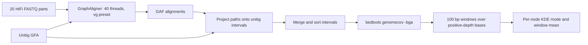

# Step 2 Graph-node depth evaluation

This step estimates HiFi read depth for each unitig in the assembly graph. Reads are aligned to the graph, graph-path alignments are projected onto unitig intervals, and bedtools produces coverage intervals. A custom script summarizes coverage in 100 bp windows and reports a kernel-density mode and a mean for each covered unitig.

The [workflow script](../scripts/02_node_depth.sh) runs the alignment, interval conversion, coverage calculation, and per-node depth summarization stages.

## Workflow



## Software

| Component | Use |
| --- | --- |
| GraphAligner | Align reads to the unitig graph with `-x vg`. |
| bedtools | Used by pybedtools for interval intersection and by `genomecov` for depth. |
| Python 3, pybedtools | Run [gaf2paf.py](../scripts/node_depth/gaf2paf.py). |
| Python 3, NumPy, SciPy, matplotlib | Run [get_KDE_Mode_v2.py](../scripts/node_depth/get_KDE_Mode_v2.py); matplotlib is imported by the source script. |
| R, ggplot2, ggpmisc | Optional [depth-distribution plot](../scripts/node_depth/plot_depth_distribution.R). |

The Python dependencies are listed in [requirements-node-depth.txt](../requirements-node-depth.txt).

## Inputs and dataset selection

- `hifiasm.asm.bp.p_utg.gfa`: the unitig graph being evaluated.
- `hifiasm.asm.bp.p_utg.fa.fai`: a matching unitig FASTA index, providing node names and lengths to bedtools.
- `SCM.hifi.part_001.fq.gz.20k.fq.gz` through `SCM.hifi.part_020.fq.gz.20k.fq.gz`: the 20 HiFi FASTQ parts named in the source conversion script. The [read manifest](../examples/node_depth/hifi_reads.list) lists them explicitly.

## 1 Align HiFi reads to the graph

The recorded command for each FASTQ part is:

```bash
GraphAligner -t40 -g hifiasm.asm.bp.p_utg.gfa \
  -f SCM.hifi.part_001.fq.gz.20k.fq.gz \
  -a SCM.hifi.part_001.fq.gz.20k.fq.gz.gaf -x vg
```

Repeat for the 20 files. The explicit mapping settings are **40 threads** and the **`vg` preset**. Additional mapping-quality and sequence-identity filters are not applied.

The workflow script processes the listed parts sequentially using the same mapping parameters for each part.

## 2 Convert GAF paths to unitig intervals

```bash
python3 /path/to/phasing/scripts/node_depth/gaf2paf.py \
  hifiasm.asm.bp.p_utg.gfa \
  SCM.hifi.part_001.fq.gz.20k.fq.gz.gaf \
  > SCM.hifi.part_001.fq.gz.20k.fq.gz.gaf.bed
```

The conversion helper emits six columns:

```text
read_id  read_length  unitig_id  unitig_start  unitig_end  unitig_orientation
```

It reads segment lengths and directed link overlaps from the GFA, splits each aligned graph path into node intervals, and accounts for node orientation. Its filtering and selection rules are:

| Setting or rule | Implementation |
| --- | --- |
| Minimum read length | Skip reads shorter than **1,000 bp**. |
| Near-full alignment | For the first accepted alignment of a read, a query span **strictly greater than 90%** of read length causes subsequent consecutive records for that read to be skipped. |
| First partial alignment | Accepted and represented as query-coordinate bins of **100 bp**. |
| Additional partial alignment | Accept when `len(overlapping_bins) / read_length < 0.05` and `read_end - read_start + 1 > 100`. |
| Read grouping | State is reset whenever the read identifier changes; records for a read must be consecutive. |
| Additional quality filter | No explicit MAPQ or alignment-identity filter in the converter. |

In the additional-alignment expression, `len(overlapping_bins)` is the count of overlapping 100 bp query bins, and `read_length` is measured in bases.

The converter reads hifiasm node identifiers matching `utg[0-9]+[lc]`, segment-length tags, and integer link overlaps. It converts path positions to node intervals using node lengths, link overlaps, and orientation-specific coordinate transformations.

## 3 Merge intervals and calculate coverage

Merge only the per-part HiFi conversion outputs. The wrapper uses the explicit manifest instead of the original broad `cat *bed` wildcard, so an existing merged BED is not added again on a repeated run.

The recorded column transformation and coverage command are:

```bash
awk '{print $3"\t"$4"\t"$5"\t"$1"\t"$6}' hifi.raw.bed \
  | sort -k1,1 -k2,2n > hifi.bed

bedtools genomecov -i hifi.bed -g hifiasm.asm.bp.p_utg.fa.fai \
  -bga > hifi.base.depth

gzip -c hifi.base.depth > hifi.base.depth.gz
```

`hifi.bed` puts node, start, and end in the first three columns. `-bga` produces bedGraph-style constant-depth intervals, including zero-depth regions:

```text
unitig_id  interval_start  interval_end  depth
```

The gzip command compresses the coverage intervals for the per-node depth calculation.

## 4 Estimate depth for each node

```bash
python3 /path/to/phasing/scripts/node_depth/get_KDE_Mode_v2.py \
  hifi.base.depth.gz > hifi.last.depth
```

The implementation uses these settings:

| Item | Setting |
| --- | --- |
| Window assignment | `floor(position / 100)`; **100 bp** windows anchored at coordinate zero. |
| Zero depth | Zero-depth intervals are skipped before window aggregation. |
| Window statistic | Sum of depth divided by the number of **positive-depth bases** observed within that window. |
| KDE input | The per-window values for a node, with each represented window given equal weight. |
| Kernel estimator | `scipy.stats.gaussian_kde`. |
| Bandwidth | **Scott's rule**, `bw_method='scott'`. |
| Evaluation grid | **1,000** equally spaced values from `min(window_depth) - 1` to `max(window_depth) + 1`. |
| Mode | Grid value with the largest evaluated density; `numpy.argmax` selects the first maximum. |
| Short-node fallback | With **fewer than 5 represented windows**, report the window mean in both depth columns. |
| Singular-covariance fallback | On `numpy.linalg.LinAlgError`, report the window mean in both columns. |

The output is tab-separated, without a header:

| Column | Meaning |
| --- | --- |
| 1 | Unitig/node identifier. |
| 2 | KDE depth mode, or the window mean when the fallback applies. |
| 3 | Arithmetic mean of the represented window-depth values. |

Column 3 is a mean of window statistics, with a partial window receiving the same weight as a full one. Because zero-depth bases are excluded, it is not a mean over all bases in a node. Nodes with no positive-depth bases are absent from the output.

## Repository wrapper

Copy the [HiFi manifest](../examples/node_depth/hifi_reads.list) into your working directory and make its paths match your files. Submit each stage through PBS with suitable CPU, memory, and walltime allocations. For the mapping stage, allocate 40 threads for the default command.

```bash
# Run each command in an appropriate PBS job, in this order.
bash /path/to/phasing/scripts/02_node_depth.sh map      /path/to/work /path/to/work/hifi_reads.list
bash /path/to/phasing/scripts/02_node_depth.sh convert  /path/to/work /path/to/work/hifi_reads.list
bash /path/to/phasing/scripts/02_node_depth.sh coverage /path/to/work /path/to/work/hifi_reads.list
bash /path/to/phasing/scripts/02_node_depth.sh kde      /path/to/work /path/to/work/hifi_reads.list
```

`GFA`, `FAI`, `PYTHON`, and `THREADS` can be supplied as environment variables. Their defaults reproduce the filenames, interpreter choice, and thread count shown above. The original KDE helper iterates over covered bases and retains window summaries in memory, so submit it as a compute job for a large graph.

## Optional distribution plot

The [R helper](../scripts/node_depth/plot_depth_distribution.R) accepts a text file with numeric depth values in its first column. It retains values **strictly below 200**, estimates a density with `geom_density()`, labels peaks and valleys using **`span = 10`**, and writes `<input>.pdf` at **6 × 5 inches**. The `<200` limit is specific to plotting; it is not applied by the node-depth KDE helper.

For example, an optional diagnostic of the per-node estimates can be prepared as follows:

```bash
awk '{print $2}' hifi.last.depth > node_mode_values.txt
Rscript /path/to/phasing/scripts/node_depth/plot_depth_distribution.R node_mode_values.txt
```

This example plots one mode estimate per reported node.

## Outputs

| Output | Contents |
| --- | --- |
| `<HiFi_part>.gaf` | GraphAligner alignments for each HiFi part. |
| `<HiFi_part>.gaf.bed` | Six-column read-to-node intervals from the custom converter. |
| `hifi.raw.bed` | Concatenated HiFi interval records. |
| `hifi.bed` | Reordered and sorted node intervals. |
| `hifi.base.depth.gz` | Compressed coverage intervals. |
| `hifi.last.depth` | Node ID, KDE mode/fallback, and window mean. |

This step produces depth estimates. Depth thresholds for node classification, graph pruning, or collapsed-node duplication belong to subsequent steps and are not introduced here.

## Software references

- [GraphAligner commands, presets, and GAF output](https://github.com/maickrau/GraphAligner)
- [bedtools genomecov options](https://bedtools.readthedocs.io/en/latest/content/tools/genomecov.html)
- [SciPy gaussian_kde and bandwidth selection](https://docs.scipy.org/doc/scipy/reference/generated/scipy.stats.gaussian_kde.html)
