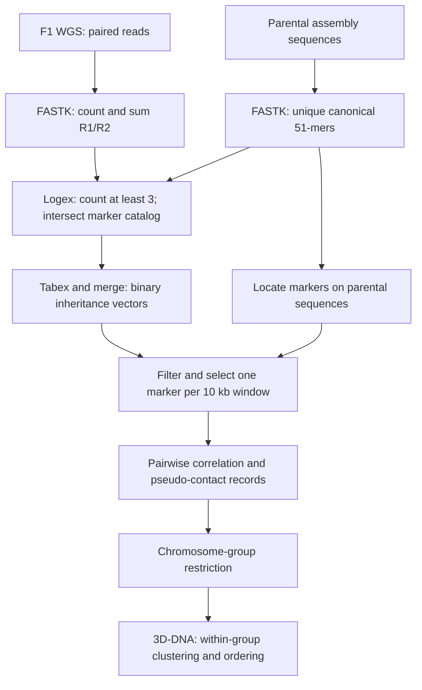

# Step 4 Progeny marker processing and S1 anchoring

Unique 51-mers from the XJDYt2t and Adina parental assemblies provide markers for tracing inheritance in the 100 F1 progeny. Each marker is represented by a binary presence/absence vector across the progeny. Correlation between vectors provides co-segregation evidence for unitig phasing within the eight chromosome groups defined in [Step 3](03-chromosome-groups.md).

## Workflow



## Software and scripts

| Component | Version or role |
| --- | --- |
| FASTK, including FastK, Logex, and Tabex | v1.2; canonical 51-mer counting, filtering, and table export. |
| Python 3, NumPy, SciPy | Marker vectors, position annotation, selection, and correlation; see [dependencies](../requirements-progeny.txt). |
| bedtools, samtools, seqkit | Windows, FASTA indexing, and group-specific FASTA extraction. |
| pigz | Compress per-individual marker lists. |
| 3D-DNA | Release 201008; iterative graph-based clustering and ordering. |

The [workflow script](../scripts/04_progeny_kmers.sh) organizes the commands into `parent`, `sample`, `merge`, `markers`, `contacts`, and `anchor` stages. Compute-intensive stages are submitted through PBS. Example filenames denote input roles rather than specific sequencing batches.

## 1 Prepare the parental marker catalog

Export parental assembly sequences to FASTA, with distinct sequence identifiers across the two parents. Count 51-mers in the combined parental sequence set, then retain canonical 51-mers occurring exactly once in that set. These markers have a unique genomic location and can be assigned to their parental sequence and position. A k-mer and its reverse complement are treated as the same canonical marker.

```bash
cat xjdy_unitigs.fa adina_unitigs.fa > parents.fa
mkdir -p tmp
FastK -v -k51 -T10 -M20 -t1 -P./tmp/ parents.fa -NG51
Logex -T10 'G51uk=A[1]' G51
Tabex G51uk | awk '$4==1 {print ">kmer"$1"\n"toupper($2)}' > unique_51mers.fa
python3 /path/to/phasing/scripts/progeny/localize_markers.py \
  parents.fa unique_51mers.fa > parental_markers.fa
```

`-k51` sets the marker length; `-t1` retains all observed canonical k-mers in the initial count table. `-T10` uses 10 threads, `-M20` sets FastK's memory budget to 20 GB, and `-P./tmp/` selects temporary storage. `A[1]` selects count-one markers.

The coordinate helper emits two-line FASTA entries with headers `node_id_start_strand`. Positions are zero-based k-mer start coordinates, and the strand indicates the canonical sequence's orientation relative to the parental sequence. This portable helper supplies the sequence-to-position conversion used by the downstream annotation scripts.

## 2 Count markers in each progeny

For each individual, count 51-mers separately in R1 and R2, sum their counts, and retain markers whose combined count is **at least 3**, equivalent to frequency **greater than 2**. Intersect this table with the parental unique-marker catalog.

```bash
FastK -v -k51 -t1 -T10 -M20 -P./tmp/ progeny001_R1.f.fq.gz -Nprogeny001_1
FastK -v -k51 -t1 -T10 -M20 -P./tmp/ progeny001_R2.f.fq.gz -Nprogeny001_2
Logex -h1000 -T8 'progeny001=(A|+B)[3-]' progeny001_1 progeny001_2
Logex -T10 'progeny001_uG=A&.B' progeny001 G51uk
Tabex progeny001_uG | pigz -p 10 -c > progeny001_uG.list.gz
```

`A|+B` combines R1/R2 tables by summing counts. `[3-]` applies the presence threshold after summation. `A&.B` retains markers shared with the parental catalog while keeping the progeny's count. Logex uses 8 threads for mate-table merging and 10 for catalog intersection. Repeat for all 100 progeny, maintaining a fixed individual order.

## 3 Build inheritance vectors

Create `uG.list`, one compressed per-individual marker list per line, in the desired sample-column order. The [example manifest](../examples/progeny/uG.list) illustrates its format; extend it to the complete 100-individual list.

The [merge helper](../scripts/progeny/merge_vectors.py) integrates the Tabex exports. It writes `1` when the retained marker is present in the individual's filtered table and `0` otherwise. It uses a bit mask internally and writes one column for each listed individual, in manifest order.

```bash
bash /path/to/phasing/scripts/04_progeny_kmers.sh merge uG.list
```

The wrapper processes all 64 three-base prefixes, then combines their outputs with one common header into `progeny.merged.tsv`. Each row contains a canonical 51-mer followed by its 100-element inheritance vector. All-zero markers are absent from this union of observed markers.

```text
kmerid    progeny001    progeny002    ...
<51-mer>  1             0             ...
```

Logex performs count filtering and catalog intersection; Tabex exports the filtered tables; the Python helper integrates those exports into the population-wide matrix.

## 4 Annotate and sample position-specific markers

The processing chain is:

```bash
samtools faidx parents.fa
bedtools makewindows -w 10000 -g parents.fa.fai > parental.10000.bed
python3 /path/to/phasing/scripts/progeny/stat_kmer.py \
  parental_markers.fa progeny.merged.tsv > marker_counts.tsv
python3 /path/to/phasing/scripts/progeny/select_window_markers.py \
  parental.10000.bed marker_counts.tsv 10000 > selected_markers.txt
python3 /path/to/phasing/scripts/progeny/filter_matrix.py \
  selected_markers.txt progeny.merged.tsv > selected_vectors.tsv
python3 /path/to/phasing/scripts/progeny/change_kmerid.py \
  parental_markers.fa selected_vectors.tsv > positioned_vectors.tsv
```

| Setting | Value |
| --- | --- |
| Genomic window | 10,000 bp, anchored at coordinate zero. |
| Minimum number of progeny carrying a marker | 6. |
| Upper carrier-count bound in the helper | 180; all carrier counts in a 100-individual matrix are within this upper bound. |
| Sampling | One eligible marker chosen randomly per occupied window. |
| Empty windows | No marker selected. |
| Position identifier | `node_id_start_strand`. |

The helper uses `random.sample` without a fixed seed. `stat_kmer.py` also reports carrier totals for the first 50 and the next 50 columns; the selection uses the total across all columns. Preserve sample-column order throughout processing. For the supplied identifier-parsing helpers, use node IDs without underscores; keep a correspondence table if parental identifiers need renaming.

## 5 Calculate correlations and create pseudo-contacts

Pairwise Pearson correlation coefficients quantify co-segregation between nonconstant binary marker vectors. For binary vectors, Pearson's coefficient equals the phi coefficient:

```text
r = (n11*n00 - n10*n01) /
    sqrt((n11+n10)*(n01+n00)*(n11+n01)*(n10+n00))
```

Here, `nab` counts progeny with the indicated pair of presence/absence states. The [source helper](../scripts/progeny/make_pseudocontacts.py) computes Kendall tau-b, which has the same value as Pearson's coefficient for these nonconstant binary vectors, including the adjustment for ties. Constant vectors have undefined correlation and do not generate accepted pseudo-contacts.

```bash
python3 /path/to/phasing/scripts/progeny/make_pseudocontacts.py \
  positioned_vectors.tsv positioned_vectors.tsv > progeny.3ddna.txt
```

For each ordered marker pair, the helper retains a pseudo-contact with probability `(r - 0.5) / (1 - 0.5)` when `r > 0.5`. Thus, retention probability rises from zero at 0.5 to one at 1. Identical node-position pairs are excluded. Two complementary fragment flags are selected randomly, and the resulting record uses the 3D-DNA merged-nodups layout with placeholder mapping-quality fields of 60. These are synthetic co-segregation links, not sequenced Hi-C reads. Random sampling is unseeded in this helper.

For large matrices, split the query into chunks while retaining the common header in **every** chunk. Compare each chunk with the complete reference matrix and concatenate the resulting pseudo-contact records. Pairwise processing scales with the product of the two marker counts.

## 6 Restrict links to each chromosome group and run 3D-DNA

Use the node lists from Step 3 to retain links for which **both** endpoint nodes belong to the same chromosome group, and extract the corresponding unitig sequences:

```bash
python3 /path/to/phasing/scripts/progeny/filter_group_contacts.py \
  chr1.utgid progeny.3ddna.txt > chr1.3ddna.txt
seqkit grep -f chr1.utgid unitigs.fa > chr1.fa
mkdir -p chr1
cd chr1
bash /path/to/3d-dna-201008/run-asm-pipeline.sh -r 1 -i 100 \
  /path/to/chr1.fa /path/to/chr1.3ddna.txt
```

`-r 1` sets one iterative misjoin-correction round, and `-i 100` sets the minimum input contig/scaffold length to 100 bp. Repeat within each homologous chromosome group. The co-segregation links drive the iterative, graph-based greedy clustering and ordering used to resolve the four haplotype-associated unitig clusters.

An equivalent wrapper invocation is:

```bash
THREEDDNA=/path/to/3d-dna-201008 \
  bash /path/to/phasing/scripts/04_progeny_kmers.sh anchor \
  chr1 chr1.utgid progeny.3ddna.txt unitigs.fa
```

The within-group clustering and ordering results provide the progeny-based unitig assignments for each chromosome group.

## Output summary

| File | Contents |
| --- | --- |
| `G51uk.ktab` and its hidden table parts | Unique parental 51-mer catalog. |
| `parental_markers.fa` | Canonical marker sequences with parental coordinates. |
| `progeny001_uG.list.gz` | Filtered marker counts for one progeny. |
| `progeny.merged.tsv` | Population-wide presence/absence vectors. |
| `positioned_vectors.tsv` | Selected vectors indexed by node, position, and strand. |
| `progeny.3ddna.txt` | Correlation-derived pseudo-contact records. |
| `chr1.3ddna.txt`, `chr1.fa` | Group-specific pseudo-contacts and unitigs. |

Retain the FastK table stub and its associated hidden `.ktab.*` files together. The sample names and FASTA paths in the examples can be replaced without changing the workflow logic.

## Methods text

> Unique canonical 51-mers were identified from the parental assembly sequences of XJDYt2t and Adina using FASTK (v1.2) and localized to their corresponding parental sequences. F1 progeny WGS reads were processed with the same k-mer length. For each individual, counts from the paired-read files were summed, and a marker was considered present when its combined count exceeded two. Logex was used for count filtering and intersection with the parental unique-marker catalog, and Tabex exports were integrated into binary inheritance vectors across the 100 progeny. To distribute markers along the assembly, one eligible marker was sampled per 10-kb window after carrier-count filtering. Pairwise Pearson-equivalent correlations between binary vectors were converted into co-segregation pseudo-contacts and supplied to 3D-DNA (release 201008) for iterative clustering and ordering within each homologous chromosome group, using `-r 1 -i 100`.

## References

- [FASTK, Logex, and Tabex](https://github.com/thegenemyers/FASTK)
- [3D-DNA release 201008](https://github.com/aidenlab/3d-dna/tree/201008)
