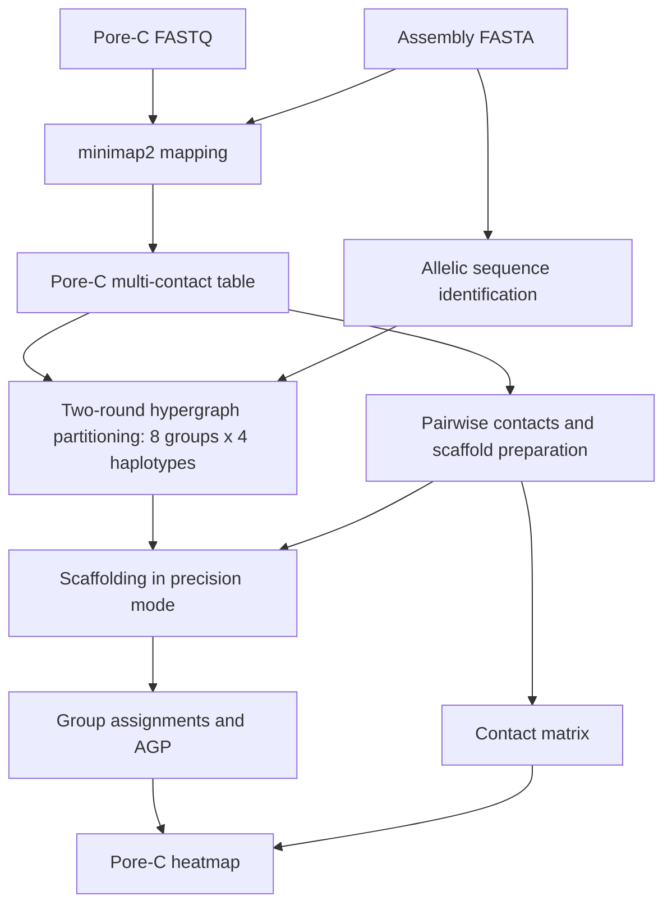

# Step 5 Pore-C data analysis and phasing

Pore-C reads were analyzed with C-phasing to provide long-range contact information for haplotype phasing. The workflow maps Pore-C reads to the assembly, constructs multi-contact and pairwise-contact representations, identifies allelic relationships, partitions sequences into chromosome and haplotype groups, and orders and orients sequences within those groups.

## Workflow



## Inputs and software

| Item | Value |
| --- | --- |
| Assembly FASTA | `xjdy_old.fa` |
| Pore-C reads | `porec_all.fq.gz`, gzip-compressed FASTQ |
| C-phasing | Source version marker `0.2.1.r283` |
| minimap2 | `2.28-r1209`, recorded in the mapping log |
| Threads | 100 |
| Grouping structure | Eight homologous chromosome groups, four haplotypes per group |

`xjdy_old.fa` is the standardized filename used throughout the example commands. Sequence identifiers must remain consistent between the FASTA, contact files, group assignments, and AGP.

## 1 Run the pipeline

Activate the C-phasing environment and make its executable and dependencies available on `PATH`. Submit the following command through PBS with a suitable allocation for 100 threads:

```bash
cphasing pipeline -f xjdy_old.fa -pcd porec_all.fq.gz -t 100 -n 8:4
```

| Option | Meaning |
| --- | --- |
| `-f` | Assembly sequences used as the mapping target and scaffolding input. |
| `-pcd` | Pore-C reads supplied directly as FASTQ. |
| `-t 100` | Thread count. |
| `-n 8:4` | Eight chromosome groups in the first partitioning level and four haplotype groups within each chromosome group. |

The [repository wrapper](../scripts/05_porec_phasing.sh) preserves these settings and accepts paths as arguments:

```bash
bash /path/to/phasing/scripts/05_porec_phasing.sh \
  /path/to/xjdy_old.fa /path/to/porec_all.fq.gz /path/to/porec_work
```

The pipeline writes its results under `cphasing_output/`. The stages below document the generated commands and their parameter values. The stage scripts can be inspected individually; run them from their corresponding stage directories when reproducing a particular stage.

## 2 Map reads and construct contact tables

The mapping log records this minimap2 invocation:

```bash
minimap2 -t 100 -k 15 -w 10 -c --secondary=no -I 4g -x map-ont \
  xjdy_old.fa porec_all.fq.gz
```

The pipeline saves compressed PAF alignments as `porec_all.paf.gz`. Mapping uses the ONT preset, 15-base minimizers, a minimizer window size of 10, CIGAR output, disabled secondary alignments, and a 4G-base index batch size.

PAF alignments are converted into `porec_all.porec.gz`, which retains the multi-contact representation of Pore-C reads. The pairwise-contact conversion retains concatemers with orders in **[2, 50)**, corresponding to 2–49 segments, and produces `porec_all.pairs.gz`. Read-mapping and concatemer summaries accompany these files.

## 3 Identify allelic relationships

The [allele-stage command](../scripts/porec/alleles.cmd.sh), run from `cphasing_output/1.alleles/`, is:

```bash
cphasing alleles -f ../xjdy_old.fa -k 19 -w 19 -m 0.5 -d 0.1 -t 100
```

The allele-identification stage uses `-k 19`, `-w 19`, `-m 0.5`, and `-d 0.1`. Its partig log additionally records `-c 60 -n 5`. The resulting `xjdy_old.allele.table` supplies allelic-relationship information for hypergraph partitioning and scaffolding.

## 4 Prepare contacts for scaffolding

The [preparation command](../scripts/porec/prepare.cmd.sh), run from `cphasing_output/2.prepare/`, is:

```bash
cphasing prepare ../xjdy_old.fa ../porec_all.pairs.gz \
  -p None -q 0 -t 100 --skip-pairs2contacts
```

The generated command uses `-q 0` and `--skip-pairs2contacts`. The restriction-site counting log records the motif **AAGCTT**, producing `porec_all.counts_AAGCTT.txt`. The preparation stage also produces `porec_all.clm.gz` and `porec_all.split.contacts` for ordering and orientation.

## 5 Partition chromosome and haplotype groups

The [hyperpartition command](../scripts/porec/hyperpartition.cmd.sh), run from `cphasing_output/3.hyperpartition/`, is:

```bash
cphasing hyperpartition \
  ../porec_all.porec.gz ../xjdy_old.contigsizes output.clusters.txt --porec \
  --mode phasing -at ../1.alleles/xjdy_old.allele.table \
  -r1 -1.0 -ir1 0.8 \
  -r2 1.0 -ir2 0.8 \
  -as 0.85 -mao 0.3 \
  -mw 0.1 -q1 1 \
  -q2 2 -mc 5 \
  -ml 10000 -ms 500000.0 \
  -t 100 -n 8:4
```

| Parameter | Value | Setting |
| --- | --- | --- |
| `--mode` | `phasing` | Haplotype-phasing mode. |
| `--porec` | Enabled | Use the Pore-C multi-contact input. |
| `-at` | Allele table | Allelic-relationship input. |
| `-r1`, `-r2` | `-1.0`, `1.0` | First- and second-round resolution parameters. |
| `-ir1`, `-ir2` | `0.8`, `0.8` | Initial resolution parameters for the two rounds. |
| `-as` | `0.85` | Allelic-similarity parameter. |
| `-mao` | `0.3` | Minimum allelic-overlap parameter. |
| `-mw` | `0.1` | Minimum graph weight. |
| `-q1`, `-q2` | `1`, `2` | Minimum mapping-quality parameters for rounds one and two. |
| `-mc` | `5` | Minimum contacts. |
| `-ml` | `10000` | Minimum contig length, in bp. |
| `-ms` | `500000.0` | Minimum output scaffold length, in bp. |
| `-n` | `8:4` | Chromosome-group and within-group haplotype counts. |

The stage writes sequence-group assignments to `output.clusters.txt`. Allelic and cross-allelic relationships are used during contact pruning within the partitioning workflow.

## 6 Order and orient sequences

The [scaffolding command](../scripts/porec/scaffolding.cmd.sh), run from `cphasing_output/4.scaffolding/`, is:

```bash
cphasing scaffolding \
  ../3.hyperpartition/output.clusters.txt ../2.prepare/porec_all.counts_AAGCTT.txt \
  ../2.prepare/porec_all.clm.gz \
  -at ../1.alleles/xjdy_old.allele.table \
  -sc ../2.prepare/porec_all.split.contacts \
  -f ../xjdy_old.fa -t 100 -o groups.agp -m precision
```

Scaffolding uses **precision** mode and writes `groups.agp`, which records sequence placement and orientation within the phased groups. The group assignments and AGP provide the Pore-C-based results for subsequent integration with the progeny-based assignments.

## 7 Generate the Pore-C contact heatmap

The [plotting script](../scripts/porec/plot.cmd.sh), run from `cphasing_output/5.plot/`, uses mapping quality **1**, a contact-matrix bin size of **10 kb**, and a displayed heatmap bin size of **500 kb**:

```bash
cphasing pairs2cool ../porec_all.pairs.gz ../xjdy_old.contigsizes \
  porec_all.q1.10k.cool -q 1 -bs 10k
cphasing plot -a ../4.scaffolding/groups.agp -m porec_all.q1.10k.cool \
  -o groups.q1.500k.wg.png -bs 500k -oc
```

This produces the assembly-ordered contact heatmap from the Pore-C pairs and scaffold AGP.

## Output summary

| Location | Output |
| --- | --- |
| `cphasing_output/` | `porec_all.paf.gz`, `porec_all.porec.gz`, `porec_all.pairs.gz`, sequence lengths and read/concatemer summaries. |
| `1.alleles/` | Allele table. |
| `2.prepare/` | Restriction-site counts, CLM and split-contact files. |
| `3.hyperpartition/` | `output.clusters.txt` and partitioning/pruning records. |
| `4.scaffolding/` | `groups.agp` and ordering/orientation records. |
| `5.plot/` | Contact matrix and assembly-ordered heatmap. |

## Methods text

> Pore-C reads were processed using C-phasing with the parameters `-t 100 -n 8:4`, specifying eight homologous chromosome groups and four haplotypes per group. Reads were mapped to the assembly using minimap2 (v2.28-r1209) with `-k 15 -w 10 -c --secondary=no -I 4g -x map-ont`. The alignments were converted into Pore-C multi-contact and pairwise-contact tables, retaining concatemers with 2–49 segments for pairwise-contact generation. Allelic relationships were identified with `-k 19 -w 19 -m 0.5 -d 0.1` and incorporated into two-round hypergraph partitioning. Partitioning used allelic similarity 0.85, minimum allelic overlap 0.3, minimum graph weight 0.1, round-specific minimum mapping qualities of 1 and 2, minimum contacts of 5, and minimum contig and output scaffold lengths of 10 kb and 500 kb, respectively. Sequences were ordered and oriented in precision mode. Pore-C contact matrices were generated at 10-kb resolution and displayed as assembly-ordered heatmaps at 500-kb resolution.

## References

- [C-phasing source](https://github.com/wangyibin/CPhasing)
- [C-phasing pipeline documentation](https://wangyibin.github.io/CPhasing/v0.2.9/basic_usage/)
- [minimap2 source](https://github.com/lh3/minimap2)
