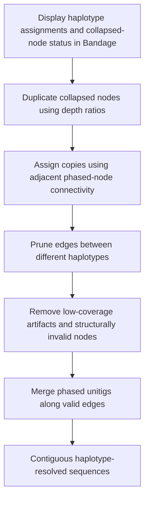

# Step 6 Graph resolution

Haplotype assignments from the progeny-based and Pore-C analyses, together with collapsed-sequence status from [Step 2](02-node-depth.md), were visualized on the assembly graph using **Bandage v0.9.0**. The graph was resolved manually by duplicating collapsed nodes, pruning haplotype-inconsistent edges, removing artifacts, and merging phased unitigs along valid connections.

## Inputs

- The assembly graph in GFA format.
- Haplotype assignments supported by [progeny inheritance vectors](04-progeny-phasing.md) and [Pore-C data](05-porec-phasing.md).
- Node-depth ratios and collapsed-node classifications from Step 2.

A depth ratio is the node's UL read-alignment depth divided by the whole-genome UL coverage-distribution peak. Nodes with ratios **>1.5** are classified as collapsed.

## Manual workflow

### 1 Duplicate collapsed unitigs and assign copies

Duplicate collapsed unitigs based on their depth ratios. Assign the resulting copies to specific haplotypes using their connectivity to adjacent, phased unitigs. The depth ratio provides copy-multiplicity evidence, while the phased neighboring nodes guide haplotype assignment and the connections retained for each copy.

### 2 Prune edges between different haplotypes

Remove edges connecting unitigs assigned to distinct haplotypes. This separates haplotype-inconsistent paths and resolves erroneous connections between homologous copies.

### 3 Remove artifacts and structurally invalid nodes

Discard low-coverage artifacts with **depth ratio <0.1**, together with unitigs exhibiting structurally invalid connections.

### 4 Merge fully phased unitigs

Merge the resulting fully phased unitigs along valid edges to reconstruct contiguous sequences. Use the graph's edge orientation and overlap information when joining adjacent sequences.

## Criteria and operations

| Item | Rule or operation |
| --- | --- |
| Collapsed-node identification | Depth ratio **>1.5**, determined in Step 2. |
| Collapsed-node duplication | Guided by depth ratios. |
| Assignment of duplicated copies | Connectivity to adjacent phased unitigs. |
| Edge pruning | Remove edges between unitigs assigned to different haplotypes. |
| Low-coverage artifact removal | Depth ratio **<0.1**. |
| Structural filtering | Discard unitigs with structurally invalid connections. |
| Sequence reconstruction | Merge fully phased unitigs along valid edges. |

These are manual graph-editing operations in Bandage. The thresholds above apply to normalized node depth; edge pruning uses haplotype assignments and graph connectivity.

## Outputs

- A resolved graph containing haplotype-specific paths.
- Contiguous sequences reconstructed by merging phased unitigs along valid edges.

## Methods text

> Haplotype assignments and the status of collapsed sequences were visualized on the assembly graph using Bandage (v0.9.0). Collapsed unitigs were duplicated based on their depth ratios, and the resulting copies were assigned to specific haplotypes guided by their connectivity to adjacent, phased unitigs. Edges connecting unitigs belonging to distinct haplotypes were pruned to resolve erroneous paths. Low-coverage artifacts with depth ratios below 0.1 and unitigs exhibiting structurally invalid connections were discarded. The resulting fully phased unitigs were then merged along valid edges to reconstruct contiguous sequences.

## References

- [Bandage source and documentation](https://github.com/rrwick/Bandage)
