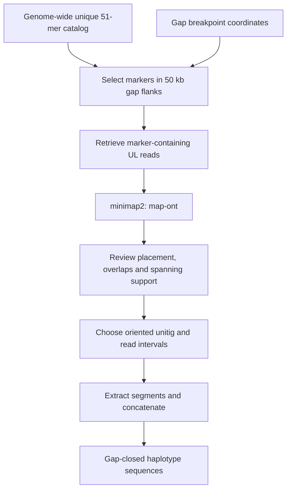

# Step 7 Haplotype-specific gap filling

Following graph resolution, the XJDYt2t assembly contained four unresolved gaps and an incomplete rDNA array on chromosome 6. This step describes closure of the four gaps using haplotype-specific UL reads and, for one gap, an isolated bridging unitig.

Genome-wide unique 51-mers in the **50 kb windows flanking each gap breakpoint** were used to retrieve UL reads from the corresponding genomic locations. Read placement and overlaps were examined using **minimap2 v2.26-r1175** with **`-x map-ont`**. The selected unitig and read segments were arranged in a reviewed coordinate plan and joined in their specified orientation.

## Workflow



## Software and inputs

| Item | Use |
| --- | --- |
| minimap2 v2.26-r1175 | UL placement and read-overlap inspection, `-x map-ont`. |
| FASTK and the Step 4 coordinate helper | Genome-wide unique 51-mer catalog and positions. |
| samtools | Retrieve candidate read identifiers from existing alignments. |
| seqkit | Convert the selected FASTQ reads to FASTA. |
| bedtools | Extract flank sequences and oriented sequence fragments. |
| Python 3 | Marker selection, read retrieval and fragment joining. |
| `xjdy_graph_resolved.fa` | Assembly sequences following graph resolution. |
| `ul_reads.fq.gz` | UL read dataset. |
| `gap_flanks.bed` | Left and right 50 kb flank windows, using BED coordinates. |

The [workflow wrapper](../scripts/07_gap_filling.sh) provides the supporting `markers`, `reads`, `align`, and `assemble` stages. Gap-path choice, overlap trimming, and placement of the bridging unitig are based on the reviewed alignments.

## 1 Define gap-flanking windows

For each breakpoint, define a 50,000 bp window in the assembled sequence immediately adjacent to the gap. Use one window from the left flank and one from the right flank, keeping the haplotype and gap identities associated with the windows. Process each gap with its corresponding flank markers and candidate-read set.

The first three columns of `gap_flanks.bed` contain:

```text
sequence_id    start    end
```

Coordinates are zero-based, half-open. For a left unitig ending at a gap, the window is its terminal 50 kb; for a right unitig starting at a gap, the window is its initial 50 kb. Orientations and chromosome assignments are retained during alignment review and fragment planning.

## 2 Select genome-wide unique markers from the flanks

Generate a genome-wide unique canonical 51-mer catalog from `xjdy_graph_resolved.fa`, using the FastK count-one selection and position annotation described in [Step 4](04-progeny-phasing.md). Count uniqueness over the assembly, then select markers by their genomic positions in the flank windows.

```bash
mkdir -p tmp
FastK -v -k51 -T10 -M20 -t1 -P./tmp/ xjdy_graph_resolved.fa -NG51
Logex -T10 'G51uk=A[1]' G51
Tabex G51uk | awk '$4==1 {print ">kmer"$1"\n"toupper($2)}' > unique_51mers.fa
python3 /path/to/phasing/scripts/progeny/localize_markers.py \
  xjdy_graph_resolved.fa unique_51mers.fa > genome_unique_51mers.fa

bash /path/to/phasing/scripts/07_gap_filling.sh markers \
  gap_flanks.bed genome_unique_51mers.fa
```

The [flank-marker helper](../scripts/gap_filling/select_flank_markers.py) selects 51-mers fully contained in the BED windows. It reads marker positions from headers of the form `sequence_id_start_strand`. The accompanying marker export writes both each selected sequence and its reverse complement to `flank_markers.txt`, allowing exact matching in either orientation within UL reads.

## 3 Retrieve marker-containing UL reads

Candidate read identifiers can be extracted from the existing UL-to-assembly alignments over the flank windows:

```bash
samtools view ul_to_assembly.bam -L gap_flanks.bed \
  | cut -f 1 | sort -u > candidate_reads.txt

bash /path/to/phasing/scripts/07_gap_filling.sh reads \
  candidate_reads.txt ul_reads.fq.gz flank_markers.txt
```

The [source read-filtering helper](../scripts/gap_filling/filter_have_kmer_reads.py) requires the read identifier to occur in the candidate list and the read sequence to contain at least one listed marker. Each matching read is emitted once per input FASTQ record. Repeat the extraction for each UL input file when the dataset is split.

The selected reads are written as uncompressed FASTQ in `gap_reads.fq`. For a manually selected subset, the [read-ID retrieval helper](../scripts/gap_filling/fish_fq.py) can extract reads by identifier from a gzip-compressed FASTQ file.

## 4 Validate read placement and overlap

Extract the gap-flank sequences and align the retrieved reads:

```bash
bedtools getfasta -fi xjdy_graph_resolved.fa -bed gap_flanks.bed \
  > gap_flanks.fa
minimap2 -x map-ont gap_flanks.fa gap_reads.fq > gap_reads.paf
```

Inspect target placement, read orientation and extension beyond the flank. For reads extending from opposing flanks, inspect their overlap with the same minimap2 preset:

```bash
minimap2 -x map-ont left_extension.fa right_extension.fa > overlap.paf
```

Genome-wide unique flank markers provide positional and haplotype-specific anchoring, while the alignments establish the compatible placement, orientation and overlap used to construct the closure.

## 5 Resolve the four gaps

| Gap | Chromosome | Closure strategy |
| --- | --- | --- |
| Gap 1 | **chr2.2** | UL reads extending from opposing flanks have unambiguous overlaps, enabling direct closure. |
| Gap 2 | **chr3.2** | UL reads extending from opposing flanks have unambiguous overlaps, enabling direct closure. |
| Gap 3 | **chr4.4** | UL reads support a direct linkage between the two flanking unitigs. |
| Gap 4 | **chr8.3** | An isolated unitig bridges the gap, with placement corroborated by spanning UL reads. |

For each gap, choose the sequence intervals from the flanking unitigs, supporting reads and, where applicable, the bridging unitig. Trim redundant overlaps before joining the intervals and record each segment's orientation.

## 6 Assemble the selected fragments

The reviewed fragment plan uses six BED columns:

```text
source_sequence_id    start    end    target_haplotype    score    strand
```

`source_sequence_id` can identify an assembly unitig or a selected UL read. The start and end specify the retained interval; `target_haplotype` identifies the sequence to reconstruct; and `strand` is `+` or `-`. List rows in the intended concatenation order for each target haplotype. The fifth column is retained as a BED score and is not used for fragment selection.

Combine the source unitigs and selected reads into a FASTA with unique identifiers, then extract and join the reviewed intervals:

```bash
seqkit fq2fa gap_reads.fq > gap_reads.fa
cat xjdy_graph_resolved.fa gap_reads.fa > fragment_sources.fa

bash /path/to/phasing/scripts/07_gap_filling.sh assemble \
  fragment_sources.fa fragment.raw.bed
```

The coordinate helper converts integer addition/subtraction expressions in the reviewed plan into numeric BED coordinates. The wrapper then runs:

```bash
bedtools getfasta -fi fragment_sources.fa -bed fragment.real.bed -name -s \
  > selected_fragments.fa
python3 /path/to/phasing/scripts/gap_filling/link_fragment.py \
  selected_fragments.fa > gap_closed_sequences.fa
```

The [original fragment-linking helper](../scripts/gap_filling/link_fragment.py) groups extracted records by the target identifier before the first colon in their FASTA headers and concatenates their sequences in input order. Strand-aware extraction applies reverse complementation before joining. The helper joins the reviewed intervals; overlap trimming is specified by the BED plan.

Integrate the reconstructed sequences into the assembly while retaining unaffected sequences. Chromosome identifiers in the gap summary above refer to the final assembly nomenclature.

## Outputs

| File | Contents |
| --- | --- |
| `flank_markers.fa`, `flank_markers.txt` | Position-specific unique markers and sequences for read matching. |
| `gap_reads.fq` | Retrieved UL reads. |
| `gap_reads.paf`, `overlap.paf` | Placement and overlap alignments. |
| `fragment.real.bed` | Numeric, oriented sequence-fragment plan. |
| `selected_fragments.fa` | Retained, oriented sequence segments. |
| `gap_closed_sequences.fa` | Reconstructed haplotype sequences. |

## Methods text

> Following graph resolution, the XJDYt2t genome assembly still contained four unresolved gaps and an incomplete rDNA array on chromosome 6. To ensure positional accuracy and haplotype specificity of the reads used for gap filling, genome-wide unique 51-mers were identified within the 50-kb windows flanking the breakpoints of each gap. UL reads harboring these markers were retrieved, and their placement was validated using minimap2 (v2.26-r1175; `-x map-ont`). For Gap 1 (chr2.2) and Gap 2 (chr3.2), reads extending from opposing flanks exhibited unambiguous overlaps, enabling direct gap closure. For Gap 3 (chr4.4), UL reads supported direct linkage between the two flanking unitigs. For Gap 4 (chr8.3), an isolated unitig was identified that bridged the gap, and its placement was corroborated by spanning reads. The selected sequence fragments were extracted in their supported orientations and joined according to the reviewed overlap coordinates.

## References

- [minimap2](https://github.com/lh3/minimap2)
- [FASTK](https://github.com/thegenemyers/FASTK)
- [bedtools getfasta](https://bedtools.readthedocs.io/en/latest/content/tools/getfasta.html)
