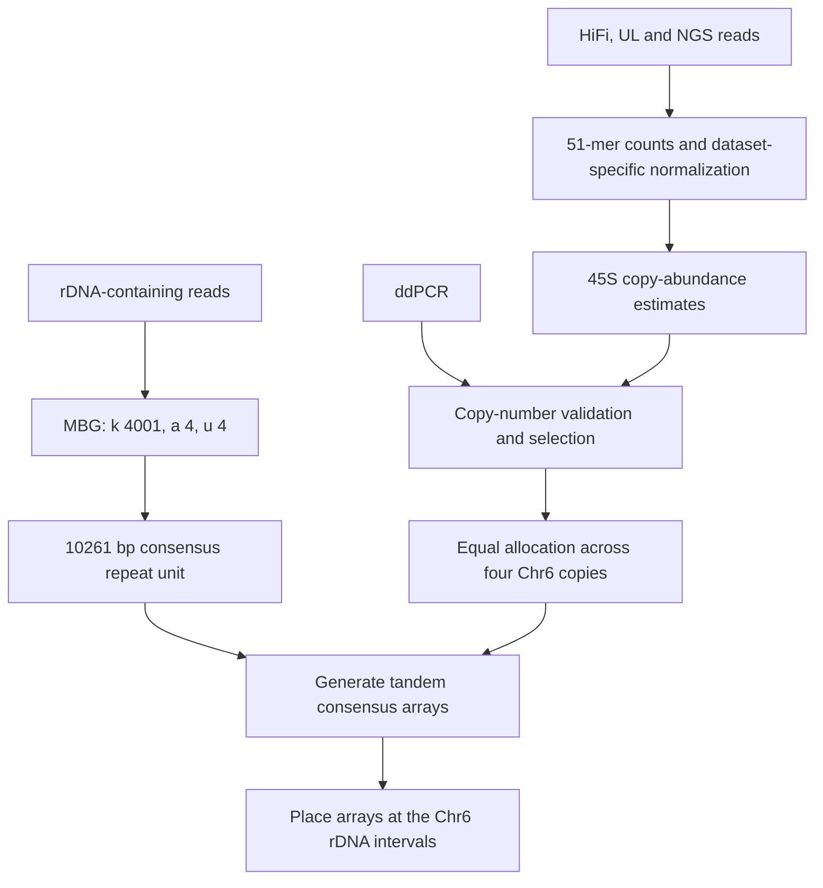

# Step 8 Consensus-based construction of 45S rDNA arrays

rDNA-containing reads were assembled with **MBG v1.0.16** using a minimizer-based de Bruijn graph algorithm, producing a single **10,261 bp consensus repeat unit**. The abundance of 45S rDNA was evaluated using HiFi, ONT UL and NGS data and validated by ddPCR. The selected total copy number was distributed uniformly across the four homologous copies of chromosome 6 to construct the final arrays.

Each constructed array consists of tandem copies of the same consensus repeat unit. The equal allocation specifies how the estimated total abundance is represented across the four Chr6 haplotypes in the assembly.

## Workflow



## Software and inputs

| Item | Role |
| --- | --- |
| MBG v1.0.16 | Assemble the rDNA repeat unit. |
| Jellyfish | Count and query 51-mers in each sequencing dataset. |
| pigz | Decompress input FASTQ files. |
| Python 3 | Count normalization and equal-array construction. |
| `rdna_reads.fq.gz` | rDNA-containing reads for repeat-unit assembly. |
| `rdna_unit.fa` | The selected 10,261 bp consensus repeat unit. |
| `rdna_18s.51mers.txt`, `rdna_5.8s.51mers.txt`, `rdna_28s.51mers.txt` | 45S component-marker lists. |
| `genome_unique.51mers.txt` | Genome-wide unique markers for the normalization baseline. |

The [workflow wrapper](../scripts/08_rdna_assembly.sh) provides `assemble`, `count`, `query`, and `arrays` stages. Submit assembly and genome-wide counting through PBS with suitable resources. Run the three sequencing-data estimates separately so that each uses its own count database and normalization baseline.

## 1 Assemble the consensus repeat unit

```bash
MBG -i rdna_reads.fq.gz -o rdna_consensus.gfa -k 4001 -a 4 -u 4
```

| Parameter | Value | Meaning |
| --- | --- | --- |
| `-k` | `4001` | Graph k-mer size. |
| `-a` | `4` | Minimum k-mer abundance. |
| `-u` | `4` | Minimum unitig abundance. |

The assembled repeat unit is **10,261 bp** long. Export the selected consensus repeat sequence as a single FASTA record in `rdna_unit.fa`. This sequence is the repeat template used for array construction. Its annotation includes the intergenic spacer/tandem-repeat region, promoter, 18S rRNA, ITS1, 5.8S rRNA, ITS2 and 28S rRNA, as shown in Extended Data Fig. 2e.

The wrapper permits a thread count through `THREADS` while retaining the three assembly parameters:

```bash
THREADS=40 bash /path/to/phasing/scripts/08_rdna_assembly.sh assemble rdna_reads.fq.gz
```

## 2 Count 51-mers in HiFi, UL and NGS data

The count settings used for the sequencing datasets are `-m 51 -s 100M -t 40`. Decompress gzip FASTQ inputs before running Jellyfish. Example commands use generic input names:

```bash
pigz -p 10 -d -c hifi_reads.fq.gz > hifi_reads.fq
pigz -p 10 -d -c ul_reads.fq.gz > ul_reads.fq
pigz -p 10 -d -c ngs_R1.fq.gz > ngs_R1.fq
pigz -p 10 -d -c ngs_R2.fq.gz > ngs_R2.fq

jellyfish count -m 51 -s 100M -t 40 -o hifi.jf hifi_reads.fq
jellyfish count -m 51 -s 100M -t 40 -o ul.jf ul_reads.fq
jellyfish count -m 51 -s 100M -t 40 -o ngs.jf ngs_R1.fq ngs_R2.fq
```

For split datasets, supply all input FASTQ files from that dataset to the corresponding count command. The query markers and baseline markers use the same count database and counting convention.

## 3 Query rDNA markers and the genomic baseline

The 18S, 5.8S and 28S marker sets provide estimates for the components of the 45S repeat. Marker-list files contain one 51-mer sequence per line. Query each component and the genome-wide unique-marker set in each database:

```bash
bash /path/to/phasing/scripts/08_rdna_assembly.sh query hifi.jf rdna_18s.51mers.txt > rdna_18s.hifi.counts.tsv
bash /path/to/phasing/scripts/08_rdna_assembly.sh query hifi.jf rdna_5.8s.51mers.txt > rdna_5.8s.hifi.counts.tsv
bash /path/to/phasing/scripts/08_rdna_assembly.sh query hifi.jf rdna_28s.51mers.txt > rdna_28s.hifi.counts.tsv
bash /path/to/phasing/scripts/08_rdna_assembly.sh query hifi.jf genome_unique.51mers.txt > baseline.hifi.counts.tsv
```

Repeat with `ul.jf` and `ngs.jf`. Query outputs contain the marker sequence and its count. The source workflow also queried 5S markers as a separate rDNA target; 5S counts are not added to the 18S/5.8S/28S estimates for 45S.

## 4 Normalize copy abundance and compare data sources

Normalize the rDNA marker counts using the genome-wide unique-marker baseline from the same dataset:

```text
relative_copy_abundance = rDNA_marker_count / genomic_baseline_count
scaled_copy_abundance = relative_copy_abundance × baseline_copy_multiplicity
```

`baseline_copy_multiplicity` specifies how many copies the normalization markers represent in the complete tetraploid genome. For markers unique across the complete assembled genome, it is 1. Keep this scale explicit when comparing sequence-based estimates with an experimental reference-locus normalization.

The [normalization helper](../scripts/rdna/copy_ratios.py) reports the count ratio and its copy-multiplicity scaling for each marker. Supply the dataset-specific baseline explicitly:

```bash
: "${HIFI_BASELINE:?Set the HiFi genomic marker baseline}"
python3 /path/to/phasing/scripts/rdna/copy_ratios.py \
  rdna_18s.hifi.counts.tsv "$HIFI_BASELINE" --baseline-copies 1 \
  > rdna_18s.hifi.copy_abundance.tsv
```

Compare the 18S, 5.8S and 28S copy-abundance distributions across HiFi, UL and NGS data. The selected total 45S copy number is validated using ddPCR and provides the abundance target for constructing the arrays.

### Final assembly count and experimental comparison

The final resolved XJDYt2t assembly contains **3,125 copies of 45S rDNA**, as reported in **Extended Data Fig. 2g**. This assembly count is compared with estimates from ddPCR, HiFi, UL and NGS data. The ddPCR results are presented as **mean ± standard deviation across ddPCR replicates**.

## 5 Allocate the total uniformly across four Chr6 haplotypes

Let N be the selected integer copy count for each Chr6 array:

```text
copies_per_haplotype = N
total_represented_copies = 4 × N
array_length_per_haplotype = 10,261 × N bp
total_array_length = 4 × 10,261 × N bp
```

All four arrays use the same consensus repeat unit and the same copy count. The selected integer N is supplied explicitly to the construction script so that the represented total is documented alongside the generated sequence.

```bash
: "${COPIES_PER_HAPLOTYPE:?Set the selected integer copy count}"
bash /path/to/phasing/scripts/08_rdna_assembly.sh arrays \
  rdna_unit.fa "$COPIES_PER_HAPLOTYPE"
```

The [array-construction helper](../scripts/rdna/build_arrays.py) checks that the input contains exactly one 10,261 bp A/C/G/T repeat unit and writes four tandem arrays:

```text
chr6.1_45S_consensus_array
chr6.2_45S_consensus_array
chr6.3_45S_consensus_array
chr6.4_45S_consensus_array
```

The accompanying TSV records the repeat-unit ID, unit length, number of repeats and array length for each haplotype. It writes array sequences rather than whole chromosomes. Place the arrays at the corresponding Chr6 rDNA intervals according to the reviewed chromosome-coordinate and orientation plan, retaining the flanking chromosome sequences.

## Outputs

| File | Contents |
| --- | --- |
| `rdna_consensus.gfa` | MBG graph for the repeat-unit assembly. |
| `rdna_unit.fa` | One 10,261 bp consensus repeat unit. |
| `hifi.jf`, `ul.jf`, `ngs.jf` | Separate sequencing-data 51-mer count databases. |
| `*.counts.tsv` | rDNA and baseline marker counts. |
| `*.copy_abundance.tsv` | Baseline-normalized marker abundance estimates. |
| `rdna_arrays.fa` | Four equal-length tandem consensus arrays. |
| `rdna_arrays.tsv` | Per-haplotype copy counts and sequence lengths. |

## Methods text

> For 45S rDNA assembly, rDNA-containing reads were assembled using the minimizer-based de Bruijn graph algorithm implemented in MBG (v1.0.16; `-k 4001 -a 4 -u 4`), yielding a single 10,261 bp consensus repeat unit. The copy number of 45S rDNA was quantified using HiFi, UL and NGS data and validated by ddPCR. The total estimated copy number was distributed uniformly across the four homologous copies of chromosome 6. The corresponding arrays were constructed by tandemly repeating the consensus unit at the selected per-haplotype copy count.

## References

- [MBG source and parameters](https://github.com/maickrau/MBG)
- [Jellyfish](https://github.com/gmarcais/Jellyfish)
