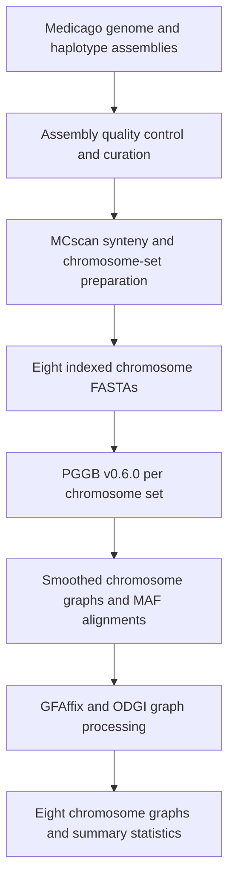

# Step 10 Construction of the Medicago graph pangenome

The *Medicago* sequence graph was constructed from 42 genome or haplotype paths per chromosome. Sequences were assigned to eight chromosome sets based on synteny with XJDYt2t. Each set was used to build a graph with **PGGB v0.6.0** and processed with **ODGI v0.8.6**.

## Workflow



## 1 Curate the assembly panel

The study's synteny-based pan-allele matrix used 45 entries, including four *M. sativa* subsp. *falcata* haplotypes. The chromosome graph input contains one *falcata* path.

| Assembly group | Entries |
| --- | ---: |
| Phased cultivated alfalfa from this study, four XJDYt2t haplotypes and four Adina haplotypes | 8 |
| Other cultivated alfalfa assemblies | 26 |
| Phased *M. sativa* subsp. *falcata* haplotypes | 4 |
| Diploid *M. sativa* subsp. *caerulea* assembly | 1 |
| Assemblies from six other *Medicago* species | 6 |
| **Total** | **45** |

All included assemblies had complete BUSCO scores greater than 90% with `embryophyta_odb10`. Contig and scaffold N50 were recorded. For contamination screening, scaffolds were aligned against NCBI NT using BLASTN with an E-value cutoff of `1e-10`. Scaffolds with a non-plant top hit were removed after manual confirmation. Assemblies with available Hi-C data were inspected in Juicebox. Scaffolds from the 25 assemblies lacking Hi-C data were re-anchored, ordered and oriented against XJDYt2t with RagTag v2.1.0. Seven large misassemblies in *M. polymorpha* were corrected using Hi-C and synteny evidence, as shown in Supplementary Fig. 19.

## 2 Prepare the chromosome input sets

Use MCscan synteny to match each assembly to the eight XJDYt2t chromosome groups. In *M. lupulina*, the reciprocal Chr5/Chr6 translocation crosses two groups. In *M. polymorpha*, two Chr6 arms lie within Chr3 and Chr5. Split the non-collinear fragments at their synteny boundaries and reconstitute the chromosome inputs so that each sequence set follows the syntenic correspondence to XJDYt2t.

Prepare one FASTA per chromosome set, with 42 uniquely named sequences in each file. The preparation scripts give each path a `#`-delimited identifier. For phased inputs, the first field includes the sample, haplotype and chromosome, followed by `#1#chrN`. Single-path inputs use the prefix `sample#1#` followed by the chromosome identifier. The curated inputs span Chr1 through Chr8.

## 3 Construct the chromosome graphs

Run PGGB v0.6.0 separately for each chromosome set. Index the input FASTA with `samtools faidx`. Set `-n 42` for the 42 input paths. The commands below show the recorded settings for Chr1. Use the same options for Chr2 through Chr8.

```bash
samtools faidx chr1/chr1.fa.gz
pggb -i chr1/chr1.fa.gz -o chr1 -n 42 -t 100 -c 1 -M -V 'Mss:#'
```

| Parameter | Value | Role |
| --- | --- | --- |
| `-n` | `42` | Number of haplotypes supplied to the graph normalization stage. |
| `-c` | `1` | Number of mappings per segment in the wfmash stage. |
| `-M` | Enabled | Write a MAF alignment of merged partial-order alignment blocks. |
| `-V` | `Mss:#` | Use paths matching the specified reference prefix for graph-derived variant output. |

Keep each chromosome's smoothed graph and MAF with its PGGB log.

## 4 Process and inspect chromosome graphs

Run GFAffix on the smoothed GFA to remove redundant graph structure. Convert the resulting GFA to ODGI format, unchop its nodes and sort the graph. The recorded ODGI jobs used 64 threads.

```bash
gfaffix chr1.smooth.gfa -o chr1.smooth.fix.gfa
odgi build -t 64 -P -g chr1.smooth.fix.gfa -o chr1.og -O
odgi unchop -i chr1.og -o chr1.unchop.og -P -t 64
odgi sort -i chr1.unchop.og -o chr1.final.og -P -p Ygs -t 64
odgi view -i chr1.final.og -g > chr1.final.gfa
odgi stats -i chr1.final.og -S
```

The chromosome-level files are named `chr1.final.og` through `chr8.final.og`. For each graph, `odgi stats -S` reports the total sequence length, node, edge, path and step counts. Each chromosome graph has 42 paths.

To calculate presence/absence ratios for BED-defined intervals, use the corresponding chromosome graph and matching path names in the BED file. The `-M` output has intervals as rows and graph paths as columns.

```bash
odgi pav -M -i chr1.final.og -b chr1.bed > chr1.tsv
```

Supplementary Tables 32 and 33 report the pan-allele groups and gene counts from synteny-based allele clustering.

## References

- [PGGB v0.6.0 source and command-line options](https://raw.githubusercontent.com/pangenome/pggb/v0.6.0/pggb)
- [ODGI source](https://github.com/pangenome/odgi)
- [ODGI interval-level presence/absence ratios](https://odgi.readthedocs.io/en/stable/rst/commands/odgi_pav.html)
