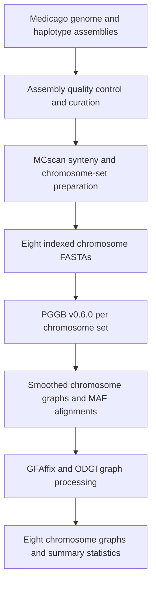

# Step 10 Pangenome and genome-wide association analyses

This step documents graph pangenome construction and the association workflow, from tetraploid variant calling through candidate gene prioritization.

- [A. Pangenome construction](#a-pangenome-construction)
- [B. Variant calling and quality control](#b-variant-calling-and-quality-control)
- [C. Dosage-resolved GWAS](#c-dosage-resolved-gwas)
- [D. Candidate gene prioritization](#d-candidate-gene-prioritization)

## A. Pangenome construction

The *Medicago* sequence graph was constructed from 42 genome or haplotype paths per chromosome. Sequences were assigned to eight chromosome sets based on synteny with XJDYt2t. Each set was used to build a graph with **PGGB v0.6.0** and processed with **ODGI v0.8.6**.

### Workflow



### 1 Curate the assembly panel

The study's synteny-based pan-allele matrix used 45 entries, including four *M. sativa* subsp. *falcata* haplotypes. The chromosome graph input contains one *falcata* path.

| Assembly group | Entries |
| --- | ---: |
| Phased cultivated alfalfa from this study, four XJDYt2t haplotypes and four Adina haplotypes | 8 |
| Other cultivated alfalfa assemblies | 26 |
| Phased *M. sativa* subsp. *falcata* haplotypes | 4 |
| Diploid *M. sativa* subsp. *caerulea* assembly | 1 |
| Assemblies from six other *Medicago* species | 6 |
| **Total** | **45** |

All included assemblies had complete BUSCO scores greater than 90% with `embryophyta_odb10`. Contig and scaffold N50 were recorded. For contamination screening, scaffolds were aligned against NCBI NT using BLASTN with an E-value cutoff of `1e-10`. Scaffolds with a non-plant top hit were removed after manual confirmation. Assemblies with available Hi-C data were inspected in Juicebox. Scaffolds from the 25 assemblies lacking Hi-C data were re-anchored, ordered and oriented against XJDYt2t with RagTag v2.1.0. Seven large misassemblies in *M. polymorpha* were corrected using Hi-C and synteny evidence, as shown in Supplementary Fig. 19.

### 2 Prepare the chromosome input sets

Use MCscan synteny to match each assembly to the eight XJDYt2t chromosome groups. In *M. lupulina*, the reciprocal Chr5/Chr6 translocation crosses two groups. In *M. polymorpha*, two Chr6 arms lie within Chr3 and Chr5. Split the non-collinear fragments at their synteny boundaries and reconstitute the chromosome inputs so that each sequence set follows the syntenic correspondence to XJDYt2t.

Prepare one FASTA per chromosome set, with 42 uniquely named sequences in each file. The preparation scripts give each path a `#`-delimited identifier. For phased inputs, the first field includes the sample, haplotype and chromosome, followed by `#1#chrN`. Single-path inputs use the prefix `sample#1#` followed by the chromosome identifier. The curated inputs span Chr1 through Chr8.

### 3 Construct the chromosome graphs

Run PGGB v0.6.0 separately for each chromosome set. Index the input FASTA with `samtools faidx`. Set `-n 42` for the 42 input paths. The commands below show the recorded settings for Chr1. Use the same options for Chr2 through Chr8.

```bash
samtools faidx chr1/chr1.fa.gz
pggb -i chr1/chr1.fa.gz -o chr1 -n 42 -t 100 -c 1 -M -V 'Mss:#'
```

| Parameter | Value | Role |
| --- | --- | --- |
| `-n` | `42` | Number of haplotypes supplied to the graph normalization stage. |
| `-c` | `1` | Number of mappings per segment in the wfmash stage. |
| `-M` | Enabled | Write a MAF alignment of merged partial-order alignment blocks. |
| `-V` | `Mss:#` | Use paths matching the specified reference prefix for graph-derived variant output. |

Keep each chromosome's smoothed graph and MAF with its PGGB log.

### 4 Process and inspect chromosome graphs

Run GFAffix on the smoothed GFA to remove redundant graph structure. Convert the resulting GFA to ODGI format, unchop its nodes and sort the graph. The recorded ODGI jobs used 64 threads.

```bash
gfaffix chr1.smooth.gfa -o chr1.smooth.fix.gfa
odgi build -t 64 -P -g chr1.smooth.fix.gfa -o chr1.og -O
odgi unchop -i chr1.og -o chr1.unchop.og -P -t 64
odgi sort -i chr1.unchop.og -o chr1.final.og -P -p Ygs -t 64
odgi view -i chr1.final.og -g > chr1.final.gfa
odgi stats -i chr1.final.og -S
```

The chromosome-level files are named `chr1.final.og` through `chr8.final.og`. For each graph, `odgi stats -S` reports the total sequence length, node, edge, path and step counts. Each chromosome graph has 42 paths.

To calculate presence/absence ratios for BED-defined intervals, use the corresponding chromosome graph and matching path names in the BED file. The `-M` output has intervals as rows and graph paths as columns.

```bash
odgi pav -M -i chr1.final.og -b chr1.bed > chr1.tsv
```

Supplementary Tables 32 and 33 report the pan-allele groups and gene counts from synteny-based allele clustering.

### References

- [PGGB v0.6.0 source and command-line options](https://raw.githubusercontent.com/pangenome/pggb/v0.6.0/pggb)
- [ODGI source](https://github.com/pangenome/odgi)
- [ODGI interval-level presence/absence ratios](https://odgi.readthedocs.io/en/stable/rst/commands/odgi_pav.html)

## B. Variant calling and quality control

Short-read whole-genome sequencing data from 358 autotetraploid alfalfa accessions were aligned to an H1 linear reference. The calling files use one coordinate system for all eight chromosomes (`chr1.1` through `chr8.1`). Each accession was genotyped at ploidy four so the VCF retains tetraploid allele dosage. The GVCF manifest and cohort VCF contain 358 samples. The site-selection script uses 385 as a fixed denominator.

### 1. Align and prepare one BAM per accession

Use a sample manifest linking each accession ID to its paired FASTQ files. Use the same reference FASTA, FASTA index and sequence dictionary for all accessions. The archived calling scripts use `chr.dantao.fa`. Verify the sequence dictionary before joining these positions to another XJDYt2t H1 assembly release.

BWA-MEM aligns the short reads. SAMtools retains alignments with MAPQ at least 1 and excludes secondary (`0x100`) and supplementary (`0x800`) records. The example uses a pair of FASTQ files for one accession and writes a coordinate-sorted BAM.

```bash
bwa mem -t "$threads" "$ref" "$r1" "$r2" \
  | samtools view -u -q 1 -F 0x900 - \
  | samtools sort -@ "$threads" -o "$sample.q1.bam" -
```

Assign the accession ID as the GATK sample name, mark duplicates and index the resulting BAM. The read-group and duplicate-marking options below are from the archived per-accession script.

```bash
gatk AddOrReplaceReadGroups \
  -I "$sample.q1.bam" -O "$sample.rg.bam" \
  -LB library1 -PL illumina -PU pl1 -SM "$sample"
mkdir -p tmp
gatk MarkDuplicates \
  -I "$sample.rg.bam" -O "$sample.markdup.bam" \
  -M "$sample.markdup.metrics.txt" --READ_NAME_REGEX null --TMP_DIR tmp
samtools index -@ "$threads" "$sample.markdup.bam"
```

### 2. Call GVCFs and jointly genotype the cohort

Run HaplotypeCaller in GVCF mode for each accession. The archive uses `-ploidy 4`, the short form of `--sample-ploidy 4`.

```bash
gatk --java-options -Xmx20G HaplotypeCaller \
  -R "$ref" -I "$sample.markdup.bam" \
  -ERC GVCF --sample-ploidy 4 -O "$sample.g.vcf.gz"
```

The archived whole-genome run imports indexed per-accession GVCFs into a GenomicsDB workspace per chromosome. It then runs `GenotypeGVCFs` for each workspace and combines the eight VCFs with `MergeVcfs`. The Methods describe a `CombineGVCFs` consolidation route.

Use `gvcf.list` with one indexed GVCF path per line. The import jobs used `-Xmx200g -Xms200g` and `--bypass-feature-reader true`. The archived joint-genotyping jobs for `chr4.1` and `chr5.1` used `-Xmx450g -Xms450g`. Set the Java memory for the compute allocation and use the same cohort for all eight complete intervals.

```bash
import_heap=${IMPORT_HEAP:-200g}
joint_heap=${JOINT_HEAP:-450g}
inputs=()
for n in {1..8}; do
  chrom="chr${n}.1"
  workspace="merge_${chrom}_database"
  mkdir -p "tmp_$chrom" "${chrom}_tmp"
  gatk --java-options "-Xmx$import_heap -Xms$import_heap" GenomicsDBImport \
    -R "$ref" --variant gvcf.list --intervals "$chrom" \
    --genomicsdb-workspace-path "$workspace" --tmp-dir "tmp_$chrom" \
    --bypass-feature-reader true
  gatk --java-options "-Xmx$joint_heap -Xms$joint_heap" GenotypeGVCFs -R "$ref" -L "$chrom" \
    -V "gendb://$workspace" --sample-ploidy 4 \
    --tmp-dir "${chrom}_tmp" -O "$chrom.cohort.vcf.gz"
  inputs+=(-I "$chrom.cohort.vcf.gz")
done
gatk MergeVcfs "${inputs[@]}" -O all.cohort.vcf.gz
```

### 3. Filter variant sites and prepare the GWAS input

The archived final site selection uses `QUAL > 50`, a positive-depth call count divided by 385 greater than 0.90 (at least 347 positive-depth calls), and more than ten nonreference carriers. The manuscript describes alternate-allele support in at least ten individuals. The counter skips missing sample fields and fields with missing or zero `DP`, then counts a carrier for each remaining `GT` containing a nonreference allele. At a biallelic site, ALT dosage 1, 2, 3 or 4 contributes one carrier per accession. Preserve missing genotypes and the four-allele `GT` field through filtering.

The final predicate operates on the site statistics table, where columns 3–5 contain site quality, positive-depth call count and nonreference carrier count. Use the retained chromosome and position keys to subset the cohort VCF.

```bash
awk 'NR > 1 && $3 > 50 && $4 / 385 > 0.9 && $5 > 10 { print $1 "\t" $2 }' \
  all.merge.vcf.f.gz.info > retained-sites.tsv
```

The final QC call set contains 48,542,275 variants, including 37,112,520 SNPs and 11,429,755 indels. For association testing, match the 358 accessions to the phenotype panel and prepare the SNP dosage matrices as described in [Dosage-resolved GWAS](#c-dosage-resolved-gwas). Record the accession IDs and per-chromosome record counts before and after site filtering.

### Repository example

[`Demos/raw.vcf.gz`](../Demos/raw.vcf.gz) is an example VCF from a subregion of `chr7.1`. [`03.filter_vcf.py`](../03.filter_vcf.py) illustrates filtering by positive depth, site quality and nonreference carrier count. Its fixed carrier cutoff is greater than four. The script expects unphased `GT:AD:DP` fields in that order and emits a simplified GT-only example and a per-site count table.

```bash
python3 03.filter_vcf.py Demos/raw.vcf.gz 0.1 > demo.filtered.vcf
```

### References

- [GATK HaplotypeCaller](https://gatk.broadinstitute.org/hc/en-us/articles/360036889312-HaplotypeCaller)
- [GATK GenotypeGVCFs](https://gatk.broadinstitute.org/hc/en-us/articles/360036727931-GenotypeGVCFs)

## C. Dosage-resolved GWAS

The diversity-panel analysis assessed 28 agronomic traits in 358 autotetraploid alfalfa accessions. The dosage scan covers all eight complete chromosomes of the H1 calling reference, `chr1.1` through `chr8.1`. The study reports 22,256,624 variant sites for the GWAS. The short `chr7.1` VCF in `Demos/` illustrates variant processing. The 100-progeny k-mer association analysis for *ML1* on chromosome 5 is a separate analysis.

### Inputs

| Input | Contents |
| --- | --- |
| Filtered genotypes | Tetraploid genotype calls from [Variant calling and quality control](#b-variant-calling-and-quality-control), converted to a numeric dosage matrix for association testing. |
| Reference and coordinate dictionary | The eight chromosomes of the reference used for variant calling. Keep that reference and its chromosome names with the genotype matrix, score files and reported intervals. |
| Sample and trait records | Matched genotype and phenotype identifiers, a trait-name crosswalk, and accession-level values for each trait. The phenotype merge represents unavailable records as `NA`. |

For biallelic VCF records, encode ALT dosage as the number of allele `1` entries in a complete tetraploid `GT`, from 0 to 4. Spot checks of the archived numeric matrix against the cohort VCF confirm ALT counting. Store missing calls as `NA`. The original genotype-export helper skipped sites with any allele longer than one base and recoded calls with `*` or missing alleles to `NA`. Match the 358 sample IDs to the phenotype file and record the number of accessions with usable values per trait. Preserve the variant's chromosome, position and allele orientation when preparing the dosage tables.

### Association model and chromosome coverage

The archived numeric drivers import one trait and its genotypes into GWASpoly with `ploidy = 4`, `format = "numeric"` and `n.traits = 1`. They request a leave-one-chromosome-out (LOCO) kinship calculation with `set.K(..., LOCO = TRUE)` and use the maximum genotype-frequency setting `set.params(geno.freq = 1 - 5/385)`. The retained numeric driver supplies no principal components or other fixed effects.

The archived job scripts dispatch a trait across `chr1.1.csv` through `chr8.1.csv` and collect chromosome-specific results. For a reproducible LOCO analysis, preserve the genome-wide marker input used to construct each kinship matrix and record which chromosome was excluded. The archived numeric driver requests LOCO while the job scripts pass chromosome-specific genotype files. These files establish the requested option and analysis coverage, but do not establish the effective kinship matrices used for the retained scores.

The manuscript lists six tests. The archived score tables used for downstream candidate selection contain those six plus two duplex-dominance columns:

| Tests | Score columns |
| --- | --- |
| Additive and general | `additive`, `general` |
| Diploidized | `diplo-additive`, `diplo-general` |
| Simplex dominance | `1-dom-alt`, `1-dom-ref` |
| Duplex dominance, present in the archived scores | `2-dom-alt`, `2-dom-ref` |

The retained file named `run.single_allmodel.R` calls an additive-only scan. The eight-column score tables are the starting point for reproducing the downstream catalogue. Reproducing their association fits requires the matching full-model driver, package version and kinship inputs.

For a new full-chromosome LOCO scan, use a single dosage table with markers from all eight chromosomes so that each kinship calculation can exclude the chromosome under test. Give the table three leading columns for marker ID, chromosome and position, then one dosage column per accession. The phenotype CSV has accession ID first and one named trait column. This example requests all model columns present in the archived score tables.

```r
library(GWASpoly)

threads <- as.integer(Sys.getenv("GWAS_THREADS", "1"))
data <- read.GWASpoly(
  ploidy = 4, pheno.file = "trait.csv", geno.file = "all-chromosomes.dosage.csv",
  format = "numeric", n.traits = 1, delim = ","
)
kinship <- set.K(data, LOCO = TRUE, n.core = threads)
params <- set.params(geno.freq = 1 - 5/385)
models <- c("additive", "diplo-general", "diplo-additive", "general", "1-dom", "2-dom")
fit <- GWASpoly(kinship, models = models, params = params, n.core = threads)
scored <- set.threshold(fit, method = "Bonferroni", level = 0.05)
trait <- names(read.csv("trait.csv", nrows = 0, check.names = FALSE))[2]
write.GWASpoly(scored, trait = trait, filename = "association-scores.tsv", what = "scores", delim = "\t")
```

The Bonferroni setting reproduces the driver's plotting threshold. Apply the locus-reporting criterion below to the exported association P values.

### Combine scores across chromosomes

GWASpoly exports marker-level scores by chromosome. The archived score-merging helper joins the chromosome files for each trait, converts each score `s` to a P value as `10^(-s)`, and preserves the eight model columns. For this export, a missing score is represented by `s = 0`, and a row is omitted if its highest score is below 2. Keep the unfiltered scores for Q–Q diagnostics and for the REF and ALT fields, which are absent from the merged export. Use the same trait IDs across files.

### Report trait-associated loci

The manuscript uses a lead-SNP threshold of `P < 1 × 10⁻⁷` and describes support by at least three neighboring SNPs with `P < 1 × 10⁻⁷` within an approximately 8-kb local LD block. The threshold was motivated by the reported LD decay distance and an effective-test estimate. Treat it as the manuscript’s reporting rule.

The retained catalogue contains 576 distinct trait–chromosome–interval records across 28 traits. The downstream candidate workflow uses reviewed trait-specific intervals and, for candidate lookup, the minimum P value among the columns in the retained score table. A historical locus-finding helper merged successive signals at `P < 1 × 10⁻⁶` separated by at most 100 kb and retained groups containing a lead signal at `P < 1 × 10⁻⁷`. That helper documents an earlier exploratory rule. Use the retained interval table to reproduce the reported loci.

Inspect unfiltered Q–Q plots by trait and model. Residual inflation and the imperfect correspondence between historical accession-level phenotypes and genotypes from sequenced plants affect interpretation of these associations. Retain the association model, sample count, lead marker and its P value when reporting a locus. See [Candidate gene prioritization](#d-candidate-gene-prioritization) for functional annotation and candidate selection within the intervals.

### Outputs

| Output | Contents |
| --- | --- |
| Chromosome-wise scores | Marker identifiers, positions and model-specific scores for all eight H1 chromosomes. |
| Trait-wise association tables | Combined model-specific P values with the export filtering recorded. |
| Q–Q and Manhattan plots | Trait- and model-specific diagnostics and genomic signal distributions. |
| Trait-associated intervals | Reviewed locus coordinates and lead markers for candidate prioritization. |

### Reference

- [Rosyara et al., Software for Genome-Wide Association Studies in Autopolyploids and Its Application to Potato](https://doi.org/10.3835/plantgenome2015.08.0073)
- [GWASpoly package vignette](https://jendelman.github.io/GWASpoly/GWASpoly.html)

## D. Candidate gene prioritization

Candidate genes were nominated from the trait-associated regions identified by dosage-resolved GWAS in 358 autotetraploid alfalfa accessions. Supplementary Table 43 reports the associated regions and candidate-gene records for the 28 agronomic traits.

### 1. Identify supported association regions

Use the association regions from [Dosage-resolved GWAS](#c-dosage-resolved-gwas). The Methods specify a genome-wide threshold of `P < 1 × 10⁻⁷` (`−log₁₀(P) > 7`) and support from at least three significant neighboring SNPs in the local LD block. Use the reported region coordinates to summarize each association.

### 2. Nominate and annotate candidate genes

Annotate variant effects with SnpEff v5.2a on the same reference used for association testing. The archived `chr.dantao` database uses gene models transferred to the calling reference with Liftoff v1.6.3. Use the gene ID cross-reference to report the corresponding XJDYt2t gene IDs. Coordinate conversion between assemblies requires a separate mapping.

For each retained region, prioritize genes with nonsynonymous protein-coding variants and record the variant effect. The archived candidate scripts rank annotated effects and use the minimum P value across models for each trait and variant. Track this candidate-variant P value separately from the lead SNP P value for the region. Retain separate records when multiple candidates are reported for one region or a gene is reported for multiple traits.

Cross-reference the candidates with *Arabidopsis thaliana* homologues to interpret known gene functions in the context of the associated trait. The reference gene set was functionally annotated using InterProScan v5.77-108.0 against Swiss-Prot, GO, KEGG and InterPro. For example, homologues of the cold-response regulators CBF2 and CBF3 co-localized with winter injury associations.

### 3. Report the candidate set

Supplementary Table 43 records the phenotype, chromosome, region bounds, lead-variant position and P value, candidate-variant position and alleles, variant effect, and gene identifier and name where available. The table contains 576 distinct trait-associated regions and 326 candidate-gene records, representing 298 distinct gene identifiers. Figure 4a shows the association results, and Supplementary Fig. 18 provides supporting plots.

Use the table as the record of the reported candidate set when comparing a reanalysis. The variant-position column identifies candidate variants for follow-up.

### 4. Select candidates for functional follow-up

The study selected six candidates carrying nonsynonymous coding variants from the trait categories chosen for follow-up. *MsLS1* was associated with stem-to-leaf ratio, *MsLS2* with leaf size, and *MsCCX2*, *MsTINY2*, *MsST1* and *MsST2* with salt tolerance. Overexpression assays evaluated projected leaf area for *MsLS1* and *MsLS2* and root elongation under salt stress for the four salt-tolerance candidates (Fig. 4b–d and Extended Data Fig. 4).
