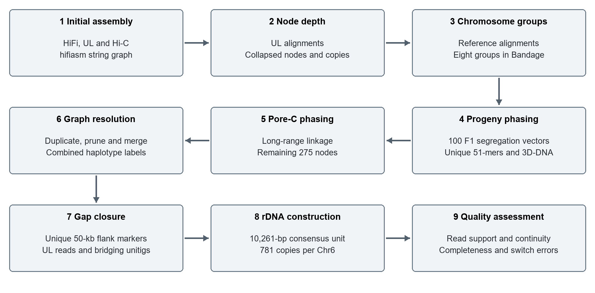

# Supplementary pipeline manual for autotetraploid genome assembly and phasing

This manual describes the nine-stage workflow used to assemble and phase the XJDYt2t genome and to evaluate the parental assemblies. HiFi and ONT ultra-long (UL) reads provide sequence and graph information; segregation of unique 51-mers across 100 F1 progeny provides haplotype linkage; and Pore-C supplies long-range information for nodes unresolved by the progeny markers. The workflow produces four haplotypes for each of eight chromosome groups, followed by graph resolution, gap closure, consensus rDNA array construction, and quality assessment.

The stages below specify inputs, commands, decision rules, and outputs. The source scripts and detailed stage documentation are available in the [phasing repository](https://github.com/socialhang/phasing). Sequence identifiers must remain consistent between the graph, exported unitig FASTA, depth tables, marker coordinates, haplotype assignments, and final assembly. Graph editing and gap-path selection are manual operations guided by the evidence described below.



Figure 1. Overview of the nine-stage assembly and phasing workflow. Progeny-based assignments are established first; Pore-C completes assignments for the remaining nodes. Both feed graph resolution together with the UL-derived collapsed-node classifications. Gap closure and consensus rDNA construction precede final quality assessment.

<!-- PAGEBREAK -->

## Software and execution conventions

| Stage | Software and recorded version | Principal role |
| --- | --- | --- |
| 1 | hifiasm 0.25.0-r726 | Initial graph assembly |
| 2 | GraphAligner 1.0.20; bedtools; NumPy/SciPy; pybedtools | UL graph alignment and node depth |
| 3 and 6 | Bandage 0.9.0; minimap2 | Chromosome grouping and graph resolution |
| 4 | FASTK 1.2, including FastK, Logex and Tabex; 3D-DNA 201008 | Progeny markers and linkage-based phasing |
| 5 | C-phasing source marker 0.2.1.r283; minimap2 2.28-r1209 | Pore-C partitioning and scaffolding |
| 7 | minimap2 2.26-r1175; FASTK; bedtools | Haplotype-specific gap closure |
| 8 | MBG 1.0.16; Jellyfish | Consensus rDNA unit and copy abundance |
| 9 | BWA-MEM 0.7.17-r1198; Winnowmap 2.03; GCI 1.0; CRAQ 1.10 | Read support and assembly continuity |
| 9 | Merqury 1.3; BUSCO 5.4.7; embryophyta_odb10; HiGlass 1.13.4 | Consensus quality, completeness and structure |

Additional utilities include samtools, seqkit, pigz, meryl, paftools.js, Perl, and Python 3. Progeny correlation helpers require NumPy and SciPy; support-separation plots require NumPy and Matplotlib. The repository includes dependency lists for node-depth and progeny processing. Version numbers in this table apply to the indicated stages; minimap2 releases differ between Pore-C mapping and gap filling.

Clone the repository and set a shell variable for its absolute location:

```bash
git clone https://github.com/socialhang/phasing.git
export PHASING=/absolute/path/to/phasing
```

Run compute-intensive commands through the cluster scheduler with matching CPU, memory, and walltime allocations. Use separate working directories for stages, parents, read types, and haplotypes. Commands assume the required executables are available on PATH. Input names in examples denote their roles; substitute the corresponding local files. Keep the FastK table stubs and their associated hidden table parts together.

BED coordinates are zero-based and half-open. Marker coordinates are zero-based k-mer start positions. Final nuclear chromosome names follow chr1.1 through chr8.4: the first number denotes the chromosome group and the second the haplotype. Use unique sequence identifiers across both parental graphs when combining their FASTA files. The notation used by marker parsers is nodeID_start_strand, so node identifiers supplied to these parsers must not contain underscores.

<!-- PAGEBREAK -->

## Step 1 Initial assembly

HiFi and UL FASTQ files were supplied to hifiasm together with paired Hi-C inputs. The command used hifiasm 0.25.0-r726 with the ONT simplex preset. The HiFi file all.filtered.fq.gz was included among the positional read inputs. The recorded input order and assembly options are:

```bash
hifiasm -t 128 -l 0 --hom-cov 340 --n-hap 4 \
  --h1 SRR9026577_1.fq.f.gz,SRR9026578_1.fq.f.gz \
  --h2 SRR9026577_2.fq.f.gz,SRR9026578_2.fq.f.gz \
  --ont round2.fq.gz ul10.pass.fq.gz \
  ul1.pass.fq.gz ul2.pass.fq.gz ul3.pass.fq.gz \
  ul4.pass.fq.gz ul5.pass.fq.gz ul6.pass.fq.gz \
  ul7.pass.fq.gz ul8.pass.fq.gz ul9.pass.fq.gz \
  all.filtered.fq.gz --dual-scaf --telo-m CCCTAAA
```

| Option | Value and interpretation |
| --- | --- |
| -t | 128 threads |
| -l | 0; disable duplicate purging |
| --hom-cov | 340; homozygous read coverage |
| --n-hap | 4 haplotypes |
| --h1 and --h2 | Matching comma-separated Hi-C R1 and R2 lists |
| --ont | ONT simplex assembly preset |
| --dual-scaf | Enable scaffolding output |
| --telo-m | CCCTAAA; telomere-identification motif |

Other settings follow this hifiasm version and preset. Within the Hi-C lists, retain the same dataset order for the two mates. The default output prefix is hifiasm.asm because no explicit -o option is supplied. Retain the unitig graph, exported unitig sequences, and run logs. The graph and FASTA must use matching node identifiers in subsequent stages.

The repository wrapper preserves the input order and command options while allowing an executable path and working directory:

```bash
HIFIASM=/path/to/hifiasm \
  bash "$PHASING/scripts/01_initial_assembly.sh" /path/to/inputs \
  > assembly.stdout.log 2> assembly.stderr.log
```

Output: the initial assembly graph and unitig sequences, used for UL depth assessment and chromosome-group partitioning. Detailed guide: [initial assembly](https://github.com/socialhang/phasing/blob/main/docs/01-initial-assembly.md).

<!-- PAGEBREAK -->

## Step 2 UL depth assessment and collapsed node identification

Align UL reads to the unitig graph with GraphAligner 1.0.20. For split datasets, repeat the alignment for each FASTQ file and combine only that dataset's interval outputs:

```bash
GraphAligner -t40 -g hifiasm.asm.bp.p_utg.gfa \
  -f ul_reads.fq.gz -a ul_reads.gaf -x vg
python3 "$PHASING/scripts/node_depth/gaf2paf.py" \
  hifiasm.asm.bp.p_utg.gfa ul_reads.gaf > ul.raw.bed
awk '{print $3"\t"$4"\t"$5"\t"$1"\t"$6}' ul.raw.bed \
  | sort -k1,1 -k2,2n > ul.bed
bedtools genomecov -i ul.bed \
  -g hifiasm.asm.bp.p_utg.fa.fai -bga > ul.base.depth
gzip -c ul.base.depth > ul.base.depth.gz
python3 "$PHASING/scripts/node_depth/get_KDE_Mode_v2.py" \
  ul.base.depth.gz > ul.last.depth
```

The GAF converter projects graph paths onto node intervals using node lengths, directed link overlaps and orientation. It skips reads shorter than 1,000 bp. A first accepted alignment spanning more than 90% of a read suppresses subsequent consecutive alignments for that read. Partial query intervals are tracked in 100-bp bins. Additional partial alignments are accepted when the number of overlapping bins divided by read length in bases is below 0.05 and the query span, calculated as end minus start plus one, exceeds 100 bp. Keep a read's alignment records consecutive. No additional explicit MAPQ or identity filter is applied.

The depth helper computes mean positive-base depth in 100-bp windows. Zero-depth bases are excluded from this calculation. For nodes with sufficient window observations, it estimates the depth mode using scipy.stats.gaussian_kde with Scott bandwidth and a 1,000-point evaluation grid from the minimum window depth minus one to the maximum plus one. Fewer than five observations, or a singular KDE covariance matrix, use the mean fallback. The output reports the node ID, KDE-mode estimate and arithmetic mean of represented window depths. Nodes with no positive-depth observations are absent from the output.

Normalize each node's KDE estimate by the peak of the genome-wide UL coverage distribution from the same read dataset. This normalized value is the depth ratio. Apply the following strict thresholds:

| Depth ratio | Interpretation and action |
| --- | --- |
| Greater than 1.5 | Classify as collapsed |
| Less than 0.1 | Classify as a low-coverage artifact for removal in Step 6 |
| Collapsed nodes | Estimate total copies as floor(depth ratio + 0.5) |

For example, depth ratios of 2.3 and 2.7 yield two and three total copies. Restore N copies by retaining the original node and creating N−1 additional copies. Adjacent phased-node connectivity determines their haplotype assignments in Step 6. Values exactly 1.5 or 0.1 do not satisfy the respective strict inequalities.

Output: per-node UL depth estimates, depth ratios, collapsed-node labels and estimated copy multiplicities. Detailed guide and wrapper: [node depth](https://github.com/socialhang/phasing/blob/main/docs/02-node-depth.md) and scripts/02_node_depth.sh.

<!-- PAGEBREAK -->

## Step 3 Manual partitioning into eight chromosome groups

Align exported unitig sequences to the reference genome xjdy_old.fa using minimap2 with the assembly preset asm5 and 40 threads:

```bash
minimap2 -x asm5 -t 40 xjdy_old.fa \
  hifiasm.asm.bp.p_utg.fa > xjdy.paf
```

Retain the best alignment for each node in xjdy.best.paf to support chromosome-group assignment. Summarize unitig-to-chromosome relationships in utg2chr.txt, with two whitespace-separated columns: unitig ID and chromosome-group label. Reference homologues such as chr1.2 are summarized at chromosome-group level as chr1. Organellar assignments are kept separate from the eight nuclear groups.

Open the GFA in Bandage 0.9.0, inspect sequence continuity, and manually partition the graph into eight homologous chromosome groups. Reference-alignment assignments for most nodes provide the primary grouping evidence. Each group contains one chromosome type and its four homologous copies; this grouping precedes within-group haplotype resolution.

Save the resulting node lists as chr1.utgid through chr8.utgid. The optional chromosome_groups/add_chr.py helper supplements a supplied group list with matching nodes from utg2chr.txt. Use a basename such as chr1.utgid because the helper derives the group name from the text before the first period:

```bash
# Run in the directory containing utg2chr.txt.
python3 "$PHASING/scripts/chromosome_groups/add_chr.py" \
  chr1.utgid > chr1.supplemented.utgid
```

The grouping facilitates interpretation of progeny segregation. Under balanced random segregation without double reduction or preferential pairing, a gamete receives two of four homologous copies. Each specified unordered pair therefore has joint transmission probability 1/6. For specified copies from independently assorting chromosome groups, joint transmission probability is 1/4. These expectations motivate within-group phasing; they are not numerical assignment thresholds.

Output: eight manually reviewed node lists and a chromosome-group annotation table. Detailed guide and reference-alignment wrapper: [chromosome groups](https://github.com/socialhang/phasing/blob/main/docs/03-chromosome-groups.md) and scripts/03_reference_alignment.sh.

<!-- PAGEBREAK -->

## Step 4 Progeny markers and linkage based phasing

Use FASTK 1.2 to identify canonical 51-mers occurring exactly once in the combined parental sequence set. Export the XJDY and Adina graph sequences with distinct identifiers. Localize the markers to their parental sequence coordinates:

```bash
cat xjdy_unitigs.fa adina_unitigs.fa > parents.fa
bash "$PHASING/scripts/04_progeny_kmers.sh" parent parents.fa
```

The parent stage runs FastK with -k51 -T10 -M20 -t1 -P./tmp/, selects count-one markers with Logex 'G51uk=A[1]', exports them with Tabex, and localizes them with localize_markers.py. FastK uses 10 threads and a 20-GB memory budget. For each of the 100 progeny, count the two WGS mates separately, sum their counts and retain markers with combined frequency at least three. Intersect with the parental catalog:

```bash
bash "$PHASING/scripts/04_progeny_kmers.sh" sample \
  progeny001 /path/to/G51uk
```

The sample stage expects progeny001_R1.f.fq.gz and progeny001_R2.f.fq.gz. It uses the same FastK settings, Logex -h1000 -T8 with '(A|+B)[3-]' to sum and filter mates, and Logex -T10 with 'A&.B' to intersect the parental catalog. Tabex exports progeny001_uG.list.gz. Place all 100 table paths in uG.list in fixed progeny order. The merge wrapper processes all 64 trinucleotide prefixes with one common header. Each marker receives a 100-element binary vector: one for presence and zero otherwise.

```bash
bash "$PHASING/scripts/04_progeny_kmers.sh" merge uG.list
bash "$PHASING/scripts/04_progeny_kmers.sh" markers \
  parents.fa parental_markers.fa progeny.merged.tsv
```

The marker stage divides sequences into 10-kb windows and randomly selects one eligible marker per occupied window. Markers must occur in at least six progeny. The source upper bound is 180, which does not exclude any carrier count in a 100-progeny matrix. Windows without eligible markers are not selected. Sampling is unseeded in the source helper; retain the selected-marker list and positioned_vectors.tsv for the evaluated run.

### Correlation encoding and within group ordering

Pairwise Pearson correlations quantify co-segregation of nonconstant binary vectors. The source helper calculates Kendall tau-b, which equals Pearson correlation for these binary vectors. Constant vectors have undefined correlation and produce no accepted pseudo-contacts. Correlations above 0.5 are encoded probabilistically: an ordered marker pair contributes a pseudo-contact with probability (r−0.5)/0.5. Identical node-position pairs are excluded. This sampling is also unseeded; retain the generated records.

```bash
python3 "$PHASING/scripts/progeny/make_pseudocontacts.py" \
  positioned_vectors.tsv positioned_vectors.tsv \
  > progeny.3ddna.txt
python3 "$PHASING/scripts/progeny/filter_group_contacts.py" \
  chr1.utgid progeny.3ddna.txt > chr1.3ddna.txt
seqkit grep -f chr1.utgid unitigs.fa > chr1.fa
bash /path/to/3d-dna-201008/run-asm-pipeline.sh \
  -r 1 -i 100 /path/to/chr1.fa /path/to/chr1.3ddna.txt
```

Here, unitigs.fa contains the listed group sequences. Repeat for all eight groups. 3D-DNA 201008 uses one misjoin-correction round and a 100-bp minimum input length to generate four haplotype-associated clusters per group. For large comparisons, split query vectors into chunks with headers and compare each to the complete reference. Retain vectors, selected markers, contacts and node assignments. Detailed guide: [progeny phasing](https://github.com/socialhang/phasing/blob/main/docs/04-progeny-phasing.md).

<!-- PAGEBREAK -->

## Step 5 Pore C phasing of remaining nodes

Progeny information established assignments for most nodes. Pore-C supplied long-range linkage for the remaining 275 nodes containing long repeats or sequences highly similar among haplotypes. Together, these stages phased all 1,111 nodes in the initial string graph. C-phasing maps reads, identifies allelic relationships, partitions the sequences, and orders and orients the resulting groups:

```bash
cphasing pipeline -f xjdy_unitigs.fa -pcd porec_all.fq.gz \
  -t 100 -n 8:4
```

The recorded C-phasing source marker is 0.2.1.r283. The mapping log records minimap2 2.28-r1209 with 100 threads and the following options:

```bash
minimap2 -t 100 -k 15 -w 10 -c --secondary=no \
  -I 4g -x map-ont xjdy_unitigs.fa porec_all.fq.gz
```

Alignments are converted to multi-contact and pairwise-contact tables. Pairwise conversion retains concatemer orders from two to 49. Allelic identification uses -k 19 -w 19 -m 0.5 -d 0.1; the partig log also records -c 60 -n 5. Contact preparation uses -p None -q 0 --skip-pairs2contacts. The restriction-site log records AAGCTT.

The generated hyperpartition command is run from cphasing_output/3.hyperpartition/:

```bash
cphasing hyperpartition \
  ../porec_all.porec.gz ../xjdy_unitigs.contigsizes \
  output.clusters.txt --porec --mode phasing \
  -at ../1.alleles/xjdy_unitigs.allele.table \
  -r1 -1.0 -ir1 0.8 -r2 1.0 -ir2 0.8 \
  -as 0.85 -mao 0.3 -mw 0.1 -q1 1 -q2 2 -mc 5 \
  -ml 10000 -ms 500000.0 -t 100 -n 8:4
```

The settings specify eight chromosome groups and four haplotypes per group; round-specific mapping-quality cutoffs of one and two; minimum graph weight 0.1; minimum five contacts; allelic similarity 0.85; minimum allelic overlap 0.3; and minimum contig and output scaffold lengths of 10 kb and 500 kb. Scaffolding uses precision mode, the allele table, restriction-site counts, CLM contacts and split contacts to generate groups.agp. The repository preserves the generated stage commands in scripts/porec/.

Generate contact matrices at 10-kb resolution with MAPQ at least one and display assembly-ordered heatmaps at 500-kb resolution. Use the resulting linkage evidence to complete assignments for nodes unresolved by progeny markers.

Output: contact representations, allele table, clusters, AGP placements and contact heatmaps. Detailed commands and wrapper: [Pore-C phasing](https://github.com/socialhang/phasing/blob/main/docs/05-porec-phasing.md) and scripts/05_porec_phasing.sh.

<!-- PAGEBREAK -->

## Step 6 Manual graph resolution

Display the combined node-haplotype assignments and UL-derived collapsed-node classifications in Bandage 0.9.0. Resolve the graph by the following ordered operations.

1. Duplicate collapsed nodes according to their estimated copy multiplicities. For a node with depth ratio greater than 1.5, round the ratio to the nearest integer, rounding half-integers upward. Retain the original node and add N−1 copies to obtain N total graph copies. Assign each copy to a haplotype according to connectivity with adjacent phased unitigs.
2. Prune edges between nodes assigned to distinct haplotypes. Retain the connections compatible with the assignments of the duplicated copies and their phased neighbors.
3. Discard low-coverage artifacts with depth ratios below 0.1 and unitigs exhibiting structurally invalid connections, as identified during manual graph inspection.
4. Merge fully phased unitigs along retained valid edges, respecting edge orientation and overlap length, to reconstruct contiguous haplotype sequences.

| Decision | Evidence or rule |
| --- | --- |
| Node haplotype | Progeny linkage first; Pore-C for remaining unresolved nodes |
| Collapsed node | UL depth ratio greater than 1.5 |
| Total restored copies | floor(depth ratio + 0.5) |
| Copy assignment | Connections to adjacent phased nodes |
| Edge removal | Endpoints assigned to different haplotypes |
| Low-depth removal | UL depth ratio less than 0.1 |
| Joining | Retained edge orientation and overlap |

These operations were performed manually. The accompanying documentation describes their evidence and thresholds; the procedure does not require an automated graph-partitioning script. Keep resolved node IDs, copy-to-haplotype assignments, retained paths and merged-sequence identifiers associated with the graph used for reconstruction.

The graph-resolution stage establishes contiguous phased paths. Residual sequence gaps are closed in Step 7. The chromosome 6 rDNA arrays are represented using the consensus-based procedure in Step 8.

Output: resolved haplotype-specific graph paths and contiguous reconstructed sequences. Detailed guide: [graph resolution](https://github.com/socialhang/phasing/blob/main/docs/06-graph-resolution.md).

<!-- PAGEBREAK -->

## Step 7 Haplotype specific gap closure

After graph resolution, XJDYt2t retained four unresolved gaps and an incomplete rDNA array on chromosome 6. To close the four gaps, identify genome-wide unique 51-mers within the 50-kb windows immediately flanking each breakpoint. Select markers fully contained in each flank and export both marker orientations. Use these markers to retrieve positional and haplotype-specific UL reads.

The FASTK count-one catalog and coordinate-localization procedure follow Step 4, applied to xjdy_graph_resolved.fa. Define the flanks in gap_flanks.bed, then use the supporting stages:

```bash
bash "$PHASING/scripts/07_gap_filling.sh" markers \
  gap_flanks.bed genome_unique_51mers.fa
samtools view ul_to_assembly.bam -L gap_flanks.bed \
  | cut -f 1 | sort -u > candidate_reads.txt
bash "$PHASING/scripts/07_gap_filling.sh" reads \
  candidate_reads.txt ul_reads.fq.gz flank_markers.txt
bedtools getfasta -fi xjdy_graph_resolved.fa \
  -bed gap_flanks.bed > gap_flanks.fa
minimap2 -x map-ont gap_flanks.fa gap_reads.fq > gap_reads.paf
```

The read filter requires both membership in the candidate-ID list and an exact match to at least one flank marker. Repeat for each UL FASTQ part. Use minimap2 2.26-r1175 with -x map-ont to inspect placement, orientation, extension beyond the flank and overlaps between reads from opposing flanks.

| Gap | Final chromosome | Closure evidence |
| --- | --- | --- |
| 1 | chr2.2 | Unambiguous overlaps between UL reads extending from opposing flanks |
| 2 | chr3.2 | Unambiguous overlaps between UL reads extending from opposing flanks |
| 3 | chr4.4 | UL-supported direct linkage between flanking unitigs |
| 4 | chr8.3 | Isolated bridging unitig supported by spanning UL reads |

Record retained sequence intervals and orientations in a reviewed six-column BED plan: source ID, start, end, target haplotype, score and strand. List intervals in concatenation order and trim redundant overlaps in the plan. Combine unitigs and selected reads into a FASTA with unique identifiers:

```bash
seqkit fq2fa gap_reads.fq > gap_reads.fa
cat xjdy_graph_resolved.fa gap_reads.fa > fragment_sources.fa
bash "$PHASING/scripts/07_gap_filling.sh" assemble \
  fragment_sources.fa fragment.raw.bed
```

The wrapper resolves integer coordinate expressions, extracts oriented fragments with bedtools getfasta -name -s, and concatenates them with link_fragment.py. Integrate reconstructed sequences into the assembly while retaining unaffected sequences.

Output: selected flank markers and reads, placement/overlap alignments, reviewed numeric fragment plan and gap-closed sequences. Detailed guide: [gap filling](https://github.com/socialhang/phasing/blob/main/docs/07-gap-filling.md).

<!-- PAGEBREAK -->

## Step 8 Consensus construction of the 45S rDNA arrays

Assemble rDNA-containing reads with MBG 1.0.16 using the minimizer-based de Bruijn graph algorithm. The selected consensus repeat unit is 10,261 bp long:

```bash
MBG -i rdna_reads.fq.gz -o rdna_consensus.gfa \
  -k 4001 -a 4 -u 4
```

Here, -k sets the graph k-mer size to 4,001; -a and -u set minimum k-mer and unitig abundances to four. Export the selected unit as a single FASTA record, rdna_unit.fa. Its components comprise the intergenic spacer/tandem-repeat region, promoter, 18S rRNA, ITS1, 5.8S rRNA, ITS2 and 28S rRNA.

Quantify repeat abundance separately in HiFi, UL and NGS data using Jellyfish 51-mer counts. Decompress FASTQs before counting; for paired NGS reads supply both mates:

```bash
jellyfish count -m 51 -s 100M -t 40 \
  -o hifi.jf hifi_reads.fq
jellyfish count -m 51 -s 100M -t 40 \
  -o ul.jf ul_reads.fq
jellyfish count -m 51 -s 100M -t 40 \
  -o ngs.jf ngs_R1.fq ngs_R2.fq
bash "$PHASING/scripts/08_rdna_assembly.sh" query \
  hifi.jf rdna_18s.51mers.txt > rdna_18s.hifi.counts.tsv
```

Query 18S, 5.8S and 28S marker lists and genome-wide unique normalization markers in each dataset. Normalize rDNA counts to the genomic baseline from that same dataset. Keep the baseline copy multiplicity explicit: markers unique across the complete tetraploid genome have multiplicity one. The copy_ratios.py helper divides marker counts by a supplied positive baseline and applies the specified baseline multiplicity. Compare the component distributions across the three sequencing datasets and with ddPCR estimates. Present ddPCR replicates as mean and standard deviation. Keep the experimentally estimated abundances separate from the chosen assembly representation.

For construction, allocate 3,124 consensus units uniformly across the four chromosome 6 homologues: 781 units per haplotype. Each array is 8,013,841 bp long, and the four arrays total 32,055,364 bp:

```bash
bash "$PHASING/scripts/08_rdna_assembly.sh" arrays \
  rdna_unit.fa 781
```

The helper validates a single 10,261-bp A/C/G/T template and writes rdna_arrays.fa and a per-haplotype summary. Place the arrays at the corresponding chromosome 6 rDNA intervals using the reviewed coordinate and orientation plan, retaining flanking sequence. Equal allocation is a consensus representation and does not resolve individual-repeat microheterogeneity or haplotype-specific copy-number differences.

Output: consensus graph and repeat unit, dataset-specific counts, normalized abundance comparisons, and four equal-length arrays. Detailed guide: [rDNA construction](https://github.com/socialhang/phasing/blob/main/docs/08-rdna-assembly.md).

<!-- PAGEBREAK -->

## Step 9 Genome quality assessment

Assess the XJDYt2t and Adina assemblies for continuity, read support, completeness, consensus accuracy and haplotype consistency. Apply haplotype-specific assessments to all four haplotypes. The wrapper scripts/09_genome_quality.sh provides independent stages.

### Basic metrics and short read support

Calculate sequence length, contig N50, gap counts and gap lengths. A gap is a maximal run of one or more Ns; contigs are the nonempty sequences between these runs. For telomeres, inspect both chromosome ends for CCCTAAA or its reverse complement TTTAGGG and provide a reviewed end-presence table to assembly_metrics.py.

```bash
bash "$PHASING/scripts/09_genome_quality.sh" basic \
  assembly.fa > assembly.metrics.json
bwa index assembly.fa
bwa mem -t 40 assembly.fa ngs_R1.fq.gz ngs_R2.fq.gz \
  | samtools sort -@ 10 -o ngs.bam
samtools index ngs.bam
samtools flagstat ngs.bam > ngs.flagstat.txt
samtools coverage ngs.bam > ngs.coverage.tsv
```

BWA-MEM 0.7.17-r1198 uses default alignment parameters. flagstat provides mapping and pairing statistics; coverage reports covered bases, coverage fraction and mean depth by sequence.

### Haplotype specific long reads and continuity

Prepare repetitive 15-mers and align HiFi and UL reads to the complete assembly with Winnowmap 2.03:

```bash
meryl count k=15 output repetitive.meryl assembly.fa
meryl print greater-than distinct=0.9998 repetitive.meryl \
  > repetitive_k15.txt
winnowmap -W repetitive_k15.txt -t 40 -ax map-pb \
  assembly.fa hifi.fq.gz > hifi.w.sam
winnowmap -W repetitive_k15.txt -t 40 -ax map-ont \
  assembly.fa ul.fq.gz > ul.w.sam
```

Convert SAM to PAF with paftools.js sam2paf. Preserve mapper order and select the first ranked alignment per read, matching the source best0 selection. Partition reads by the selected target's haplotype suffix and extract the corresponding FASTQs. Remap each read set to its own haplotype with minimap2 using -ax map-hifi or -ax map-ont and 40 threads. Sort and index BAMs and generate target-sorted PAFs.

Run GCI 1.0 with the two read types, specifying the eight chromosomes of the evaluated haplotype and MAPQ cutoff zero:

```bash
GCI -r hap1.fa --hifi hifi.hap1.bam hifi.hap1.paf \
  --nano ul.hap1.bam ul.hap1.paf \
  --chrs chr1.1,chr2.1,chr3.1,chr4.1,chr5.1,chr6.1,chr7.1,chr8.1 \
  -t 10 -p -it pdf -mq 0 -d gci.hap1
bash "$PHASING/scripts/09_genome_quality.sh" effective \
  hap1.fa uncovered_regions.bed
```

GCI supplies continuity scores and uncovered-region intervals. Mask uncovered intervals to N and split at N-runs to calculate effective contig N50. The wrapper reports this as contig_N50_bp in effective.metrics.json.

### Error assessment and completeness

Use CRAQ 1.10 with the short-read and UL BAMs to estimate errors and calculate regional and structural assembly quality indices, R-AQI and S-AQI. BAM target identifiers must match the evaluated FASTA:

```bash
craq -ngs ngs.bam -sms ul.hap1.bam -g hap1.fa \
  -q 0 -t 10 -D craq.hap1
meryl count k=21 output ngs.k21.meryl \
  ngs_R1.fq.gz ngs_R2.fq.gz
bash "$MERQURY/merqury.sh" ngs.k21.meryl assembly.fa assembly
busco -m genome -i hap1.fa -o busco.hap1 \
  -l /path/to/embryophyta_odb10 -c 10 --offline
```

Merqury 1.3 evaluates read-k-mer completeness, consensus QV and error rate from a 21-mer NGS database; the k-mer size is set during meryl counting. For the complete tetraploid evaluation, assembly.fa contains all four haplotypes. BUSCO 5.4.7 evaluates each haplotype separately with embryophyta_odb10. Predicted protein sets can be assessed separately in proteins mode; distinguish these results from genome-mode results.

### Switch error evaluation

For the final assembly, identify unique 51-mers and randomly select one eligible marker per informative 10-kb window. Generate the 100-progeny presence/absence vectors and correlation-derived pseudo-contacts using the logic in Step 4. Bin contact endpoints into 10-kb windows, exclude identical-window pairs, count repeated ordered pairs, and accumulate support for each of the four homologous haplotypes within the same chromosome group. The predicted haplotype is the one with maximum accumulated support.

| Parameter or decision | Source workflow |
| --- | --- |
| Window size | 10,000 bp |
| Presence in a progeny | Combined marker count at least three |
| Candidate window | Predicted haplotype differs from assembled haplotype |
| Minimum support | Sum across four haplotypes strictly greater than 200 |
| Interval merging | Merge candidates separated by at most 50,000 bp |
| Minimum retained region | Length strictly greater than 10,000 bp |
| Error rate | Retained merged-region length / full haplotype length |

Merged-region lengths include intervening spans joined by the 50-kb rule. Isolated 10-kb candidates are removed by the length filter. For Pore-C evaluation, replace the progeny pseudo-contact input with Pore-C contacts and apply the same accumulation and interval-filtering logic. Evaluate the modalities separately:

```bash
samtools faidx assembly.fa
bash "$PHASING/scripts/09_genome_quality.sh" switch \
  progeny.mnd assembly.fa.fai progeny
bash "$PHASING/scripts/09_genome_quality.sh" switch \
  porec.mnd assembly.fa.fai porec
```

MND records supply chromosome and position in columns 2–3 and 6–7. The per-window statistics have seven columns: window ID, assembled haplotype, predicted haplotype, and support for haplotypes 1–4. Fully tied maxima select the first maximum in haplotype order 1–4; there is no additional near-tie threshold. Constant progeny vectors produce no accepted pseudo-contacts. Windows without effective marker/contact support are not called as candidate errors, although the denominator remains the full haplotype length.

The public accumulator retains the source implementation: a window's first encounter initializes four zero counters, and subsequent encounters add support, so its initializing contribution is omitted. Upstream Perl hash order can change which pair is encountered first. This implementation detail is documented in scripts/quality/README.md. Preserve the evaluated support tables when tracing the reported results.

To visualize haplotype-support separation in progeny data, plot the highest and second-highest support fractions and the empirical distribution of their normalized difference:

```bash
python3 "$PHASING/scripts/quality/plot_support_separation.py" \
  --dataset 'XJDYt2t progeny=progeny.stat.tsv' \
  --outdir support_separation
```

The plotting helper includes windows with total support greater than 200, before mismatch selection and interval merging. It exports density and cumulative-distribution plots, a low-margin inset, window metrics, counts and input checksums. Values plotted are normalized accumulated supports. Descriptive low-margin summaries do not introduce new error-calling thresholds.

### Structural inspection and retained outputs

Visualize Hi-C and Pore-C contact maps in HiGlass 1.13.4 to inspect chromosome-scale continuity and anomalous contact patterns. Review candidate switch regions alongside the contact maps and progeny linkage evidence. Retain the basic metrics, mapping statistics, GCI and CRAQ reports, Merqury and BUSCO outputs, per-window support tables, merged switch intervals, rates and reviewed contact maps.

Detailed guide: [genome quality assessment](https://github.com/socialhang/phasing/blob/main/docs/09-genome-quality.md). The source behavior of helper scripts is described in scripts/quality/README.md.
